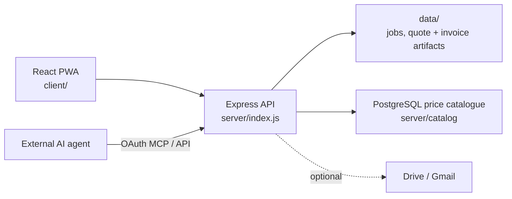
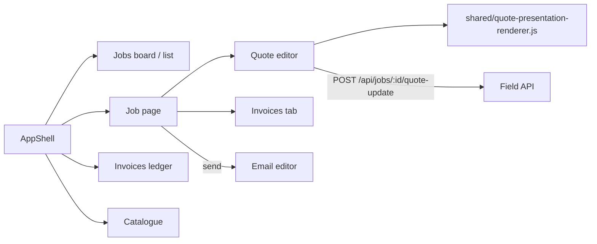
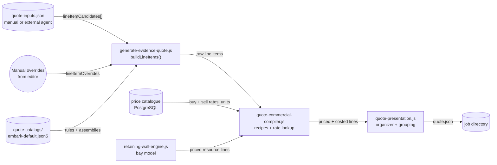
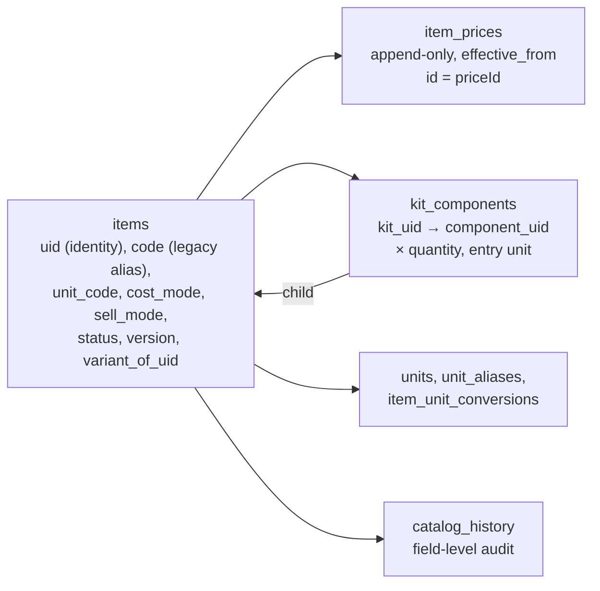
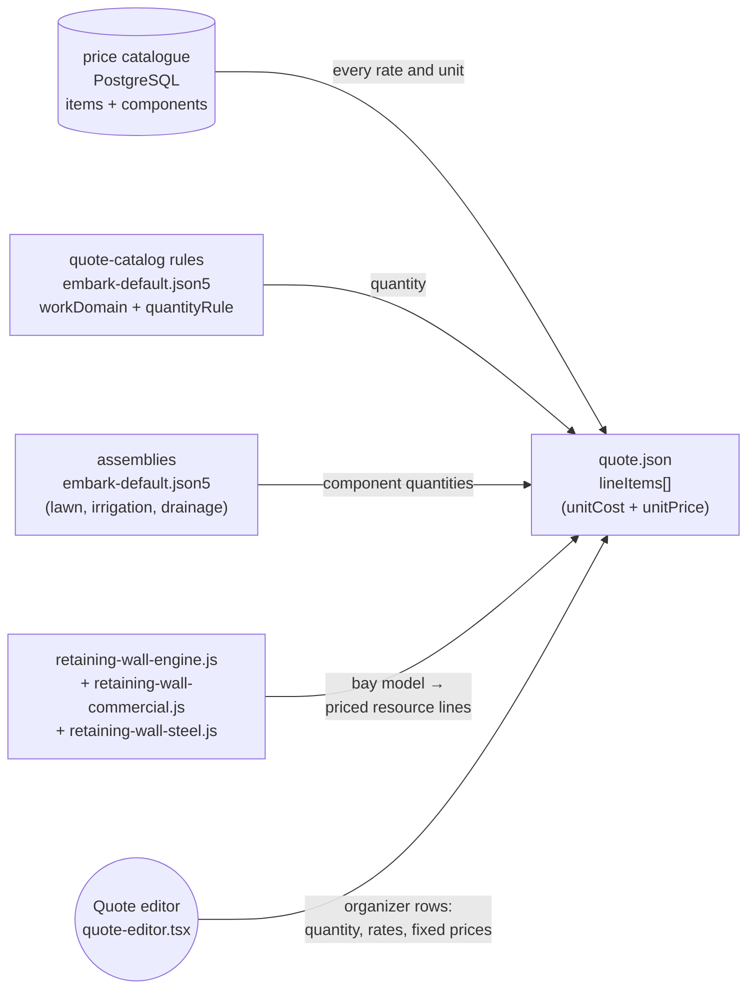
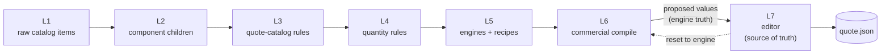
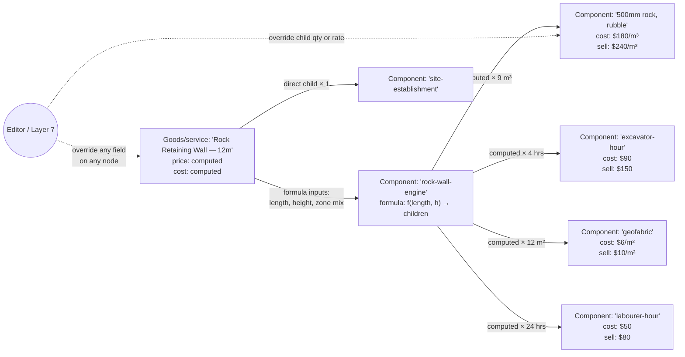

# Architecture

_Last updated: 2026-10-12_

This maintained repository document describes implementation and target
architecture truth for Field. Requested work, priorities, status and delivery
evidence live in GitHub issues and pull requests; do not copy transient status,
estimates, or delivery checklists into this file.

The SQLite and filesystem structures below are the current state, not the
accepted target. The target is a converged PostgreSQL schema defined with
Drizzle, with forced row-level security and tested recovery.

## System Boundary

Field is a quote-building and invoicing app (`VISION.md`). It has
no voice or photo capture, no job management (dispatch, tasks), no in-app
agent chat and no model calls. External AI systems drive it through the
remote MCP server, the HTTP API and the `field` CLI.

- `client/` is the operator-facing React PWA.
- `server/index.js` is the single Express runtime: API routes, auth, quote and invoice actions, Gmail, the remote MCP server, and static hosting of `client/dist`.
- `server/auth/` is human sign-in with Clerk (`FIELD_AUTH=clerk`): Clerk proves who someone is; the PostgreSQL `users` table holds the person and `org_memberships` their role (owner, staff) and approval status in an organisation. CLI/API tokens (`users.json`) and MCP OAuth stay Field-issued. With `FIELD_AUTH` unset, `server/users.js` password sign-in is used as before. See `docs/CLERK_SIGN_IN.md`.
- `data/` is the runtime boundary for job records (the container each quote and its invoices live in), quote artifacts, invoices, scheduled email, MCP OAuth state, and user records. Older jobs may still carry recordings, photos, transcripts, chat or dispatch files; Field keeps reading transcripts, quote inputs and evidence packs as stored data but no longer produces or interprets them.
- `server/storage/fs.js` and `fs-promises.js` are the only modules in the server process that import `node:fs` (the build-time `server/db/clean-dist.js` is exempt); a guard test enforces it. They pass every call through and hand each successful write under the data directory to a write-recorder hook. SQLite writes to `field.db` go through `better-sqlite3`, not this seam.
- `server/storage/durable-store.js` registers that hook when `FIELD_STORAGE=postgres`: `data/` becomes a working copy of PostgreSQL (`field_blobs`, `field_files`, `field_sqlite_images`). Boot takes a single-writer advisory lock and rebuilds `data/` before listening; writes are collected per request (AsyncLocalStorage) and stored in one transaction before a non-GET response is sent, at commit points (`server/storage/durable-hooks.js`: job-generation publish, users/OAuth/Gmail token saves, scheduled-email claims), on scheduler ticks, every 5 minutes and on SIGTERM. `field.db` is stored as a whole-database image. Unset, nothing is registered and Field runs exactly as before. `scripts/migrate-data-to-postgres.js` imports an existing data directory and verifies it, and runs the legacy catalogue import (`server/catalog/legacy-import.js`) in the same transaction.
- `server/db-runtime/` is the one PostgreSQL entry point: `getDb()` returns the Drizzle instance for `DATABASE_URL`/`FIELD_DB_URL` (postgres.js), or PGlite under `data/pglite` only when local development opts in (`FIELD_PGLITE=1`, set by `npm run dev`; refused on Replit). With neither, nothing is opened and `getDb()` fails closed. Boot applies the `server/db/drizzle` migrations before listening. The price catalogue lives there (below).
- `server/data-migrations/` changes existing records once, at boot, after the schema migrations and before Field serves. Each migration plans and verifies before it writes, and is recorded in `data_migrations` so it never runs again; a failure stops boot. The quote and invoice row backfills run here per job: a job that does not verify is logged with both numbers and skipped, and the backfill stays unrecorded so the next boot retries it. `FIELD_DATA_MIGRATIONS_HOLD=<id>|all` skips them. `npm run data:migrate -- --dry-run` plans and verifies only; in the published app, `GET /api/admin/data-migrations/dry-run` (admin only, the owner with Clerk sign-in) does the same against the live data and database and writes nothing.
- `server/documents/replicator.js` (#12) copies issued document bytes to a locked Cloudflare R2 bucket when `FIELD_DOCUMENT_REPLICA=r2`. PostgreSQL stays the store of record: `document_blobs` is written in the issue transaction as before, and after it commits the blob is copied to `<org_uid>/<sha256>` (HEAD first, then a create-only PUT; never an overwrite or a delete), with a scheduler tick that retries and backfills a few blobs a minute. Progress is in `document_blob_replicas`. Reads come from PostgreSQL and fall back to R2 only for bytes PostgreSQL cannot give, hash-checked. R2 being down marks the replica degraded in `/health`; it never stops Field serving or issuing. Unset, Field runs exactly as before. Setup and checks: `docs/REPLIT.md` "Issued documents in R2".
- `data/field.db` is the local SQLite index for jobs, evidence files, and notes. The job list reads it, so every boot reconciles it with the job folders (`reconcileJobIndex` in `server/field-db.js`): a folder it does not point at is read through `readJobMeta` (the active generation) and added, and a row whose folder was renamed is pointed at the new one. While running, a list that finds a row whose folder is gone reconciles again; opening a job by id that the index lost indexes it. Rows are never removed by a reconcile, so a deleted job (folder, then row) never comes back.
- `server/catalog/` is the price catalogue, Field's commercial authority, in PostgreSQL tables (`server/catalog/README.md`). Field refuses to boot without a reachable catalogue that has active items (unless the emergency override allows a degraded boot). The SQLite `data/price-catalog/catalog.db` is an import source only (`npm run catalog:import-legacy`); backups are the database's point-in-time restore plus `npm run catalog:export`.
- `quote-catalogs/` holds quote rules (which catalogue item each rule prices from, keywords, presentation), quantity rules, and assemblies: the lawn, irrigation and drainage recipes as data (`server/catalog/assemblies.js`). It holds no prices and no sold units (a rule that carries `unitPrice` or `unit` is refused at load); each rule declares only `quantityUnit`, the unit its quantity is measured in, and fails closed when the catalogue item is sold in a unit that cannot convert to it.
- `scripts/` holds the operator CLI and deploy helpers, and `package.json` now exposes one installable CLI bin: `field`.

## Runtime Shape

## Quote Flow

1. A quote starts as a manual job (`POST /api/jobs/manual`, the MCP `field_quote_draft_create` tool, or the CLI). Quote inputs (`lineItemCandidates`, measurements, assumptions) arrive through `PUT /api/jobs/:id/quote-inputs`, quote edits, notes, Moasure measurement files, or an external agent. Field does not extract them itself.
2. The server persists inputs under `data/` and indexes the job in `field.db`.
3. The deterministic evidence pack, review state and gaps are rebuilt from the stored inputs.
4. `quote-workflow.js` compiles deterministic quote lines against the active commercial authority. Scope text is the operator's manual text, or the bullets derived from visible schedule items.
5. Presentation logic applies customer-facing grouping, exclusions, manual items, and totals without rewriting upstream evidence.
6. Artifacts are written back to the job directory, quote versions are snapshotted when required, and optional downstream sync and send paths run.

A job's commercial files (`meta.json`, the quote and its versions, `quote-lifecycle.json`, issued documents, milestone invoices) live in committed generations under `.field-generations/` (`server/job-generation.js`). Every change is made in a staged copy by `runAtomicJobGeneration` and published as a new generation. A committed generation is never edited in place: reads re-hash it against its commit marker, and one that changed is quarantined (`.quarantine-g-NNNNNN-<uuid>`, never stored by durable storage) while the job falls back to the previous generation. The commercial writers therefore refuse a committed generation (`resolveWritableJobGeneration`). Operational truth (job state, activity, evidence) stays at the job root. `scripts/find-quarantined-generations.js <dataDir>` is a read-only report of jobs that lost a generation this way.

## Client App

The React client (`client/src`) is one shell around four areas. Every
protected route renders inside `components/shell/app-shell.tsx`: the sidebar
(search, Jobs, Invoices, Catalogue, recent jobs, account), the command palette
(⌘K), the new-quote dialog (N) and toasts. Styles for the shell and the pages
built on it live in `components/shell/ui.css` (see `DESIGN.md`).

| Route | Screen | Source |
| --- | --- | --- |
| `/jobs` | Pipeline: what needs doing, then jobs as a board by stage or a list | `features/jobs/jobs-page.tsx` |
| `/jobs/:id` | One job: the quote editor or its invoices, notes, and a summary rail | `features/job/job-page.tsx` |
| `/jobs/:id/email-editor` | Compose and send a quote, invoice or receipt | `features/job-detail/quote-email-page.tsx` |
| `/invoices` | Every milestone invoice across jobs, with payments | `features/invoices/invoices-page.tsx` |
| `/pricing`, `/pricing/import` | The catalogue: price book, item editor, categories, health; supplier price-list imports | `features/catalogue/catalogue-page.tsx`, `features/pricing/supplier-import-page.tsx` |
| `/settings` | Account (Clerk's own screens in Clerk mode), team, terms, appearance | `features/settings/settings-page.tsx` |

Job status on every screen comes from `lib/job-status.ts`, derived from the
job list's meta: Draft, Quoted, Invoicing (landed with open invoices), Paid
(landed, every invoice paid) and Lost. `lib/use-jobs.ts` keeps one shared job
list so the sidebar, board and ledger never refetch from cold.

The quote editor (`features/job/quote-editor.tsx`) edits the presentation
organizer in place and saves drafts as the operator works. It never prices
anything itself: rows and totals come from `shared/quote-presentation-renderer.js`,
the code the server and PDFs use. `features/job/quote-organizer.ts` holds the
pure tree operations (insert, move, remove, sections, one-off lines). A sent
version is read-only until the operator starts a new version; a quote the
server returns with its amounts withheld (pricing checks not passed) is also
read-only, so the blanked amounts are never saved back.

The retaining-wall 3D viewer that used to sit in the job page was removed with
the redesign; its render endpoints remain (below).

## Retaining-Wall Render Path

- `server/wall-zones.js` is the server boundary for retaining-wall discovery, pricing reconciliation, fallback resolution, and render payload assembly.
- `buildWallZoneRenderPayloadForJob` reads the job's wall-zone definition, resolves the stored or dynamic wall model, merges live quote pricing when available, and attaches measurement overlays before calling `buildRetainingWallRenderPayload`.
- `shared/retaining-wall-render.js` remains the single wall-render payload + HTML renderer pair. The recent work extended this path instead of creating another renderer.
- `server/index.js` serves both contracts from the same endpoint:
  - default: JSON payload
  - `?format=html`: full themed Plotly page

### Historic Job Coverage

- Existing retaining-wall jobs are not gated on new backfilled artifacts if they already carry the older single-wall files.
- `readWallZones(jobDir)` first tries `wall-zones.json`.
- If that file is missing, it falls back to `buildSingleWallFallbackZone(jobDir)`, which constructs a renderable wall zone from `bay-model.json` plus optional `bay-heights.json` and `wall-design.json`.
- This means the new 3D wall review path applies to prior quoted wall jobs opportunistically at read time instead of through a separate migration framework.

## Moasure Overlay In Wall Models

- The wall renderer now exposes both engine geometry and source measurements in the same Plotly scene.
- The payload can carry `measurementOverlay`, which is built from the zone's `sourceCsvPath` when present, or from the job's original Moasure imports when that is the only available source.
- Measurement CSVs, including a `sourceCsvPath` under `moasure/raw/`, are resolved beside `wall-zones.json` first and then at the job root. Moasure evidence is root-authoritative, so a commercial generation, and the staged directory a quote build runs in, never contains it. A historical render reads only its version's own files.
- Plotly traces are split so operators can toggle them independently in the legend:
  - engine geometry
  - path 1 boundary/profile line
  - path 2 probe points
- Probe hover content is intended to explain the relationship between a probe reading and the nearest bay height, preserving z-elevation rather than flattening the measurement data.

## Quote Engine Internals

The quote pipeline has four distinct compile stages, each with its own authority. Understanding the split matters because cost data currently takes a different route through the system than sell price does, and because the manual editor (step 4) today only overrides sell price.

**Authority per stage:**

| Stage | File | Owns |
|---|---|---|
| 1. Quote inputs | `PUT /api/jobs/:id/quote-inputs`, quote edits, MCP tools | Shape of quote-input records; no pricing. Field no longer extracts these with a model |
| 2. Line-item build | `server/generate-evidence-quote.js` (`buildLineItems`, line 997) | Rule resolution, quantity rules, manual override injection (line 1072) |
| 3. Commercial compile | `server/quote-commercial-compiler.js` | Recipe resolution, cost + sell from the catalogue only; a missing rate fails the line closed with the item named |
| 4. Presentation + edit | `server/quote-presentation.js`, `client/src/features/job/quote-editor.tsx` | Grouping, sections, customer-visible rollups, organizer rows and fixed prices (`commercialAdjustments` for API and CLI callers) |

**Where `unitCost` comes from.** The commercial compiler takes `unitCost` from the price catalogue item the rule resolves to (`rule.priceCatalog.buyPrice`, mirrored as `rule.authorityPricing.buyingRate`), or from a unit cost supplied with the line or an operator adjustment. There is no fallback markup: with neither, the line is a pricing issue naming the item, and the quote stays unverified until the catalogue has the rate.

The manual editor path in stage 4 **can now override both `unitPrice` and `unitCost`** via `commercialAdjustments`, while the presentation organizer can override rolled-up displayed totals and reset them back to engine truth without mutating upstream compile output.

## Pricing Catalog Model

The price catalogue is PostgreSQL tables (`server/db/src/schema.ts`), read and written only through `server/catalog/` (details in `server/catalog/README.md`). It is a recursive item tree: any item can have components, and a kit's price is either its own or rolled up leaf-first from its components' prices times their quantity.

- **Identity is `uid`.** Components, prices, conversions, evidence and history key on it, so the name is editable. `code` is a legacy alias: since migration 0006 it never changes, and every code an item has had is a row in `item_code_aliases` (unique case-insensitively), so older references still find the same item. `variant_of_uid` links a variant to its original.
- **Prices are append-only `item_prices` rows.** The current price is the latest row with `effective_from <= now`; its id is the `priceId` quote lines record. Edits append a row; a future-dated row takes effect on its date.
- **One roll-up** (`server/catalog/rollup.js`) prices every item for every reader: the quote pricing snapshot, the rate card, the item editor, health and the quote-line interfaces. A missing, archived or unpriced component makes the kit unpriced, never zero.
- **Units are typed.** Conversions exist only within a dimension (min ↔ hour, mm ↔ m) or through an item's own conversion (a disposal item's density or load capacity), and a component entered in an inconvertible unit is refused.
- **Optimistic concurrency.** Every item has a `version`; writes may name the version they were based on and are refused when stale. Every write bumps `catalog_meta.version`, the catalogue's ETag.
- Pricing reads one immutable snapshot of the whole catalogue (`loadCatalogState`), so a quote build never sees half of a concurrent edit; the snapshot is reloaded only when the catalogue version moves.
- The catalogue's "need attention" filter (`/pricing?health=1`; `/pricing/health` redirects there) and `/api/price-catalog/health` report data problems without changing data: items pricing references that are missing or archived, archived items still in use, duplicate active names (and those priced differently), `-copy` codes, cost above sell, missing prices or categories, computed kits without components, disposal costing-basis gaps, and unit problems. A catalogue with such problems still boots; each quote, rate card or wall build that needs a problem item is refused with the item named.
- **Catalogue screen.** `/pricing` is one table over the price-book grid (`server/catalog/price-book.js`, `client/src/features/catalogue/`); an item opens in place in a side sheet (`?item=<uid>`) and saves its edits together, bulk edits are previewed before they apply, and the Manage sheet handles categories, tags, units and suppliers; supplier price lists are imported as a staged, classified diff (`server/catalog/price-import.js`) that applies in one transaction from an effective date, or is discarded. Imports never delete items. See `server/catalog/README.md`.
- Quote snapshots are not catalogue data. The SQLite `quote_snapshots` table was never written and was not carried over; the PostgreSQL `quote_snapshots` table is described under "Quote Catalogue Links And Send Snapshots".

**What's inconsistent with the target model (see "Target: Unified Item Model" below):**
- The lawn, irrigation and drainage recipes are assemblies (quote-catalog data, priced from the catalogue); the retaining-wall engine stays code (it walks a bay model the expression language cannot express) but prices only from the catalogue. The empty `assembly_*` tables were dropped in migration 0007; measured formulas are deferred.
- The compiler still resolves through a branching ladder (catalog lookup, recipe, retaining-wall engine) rather than one catalog-tree resolver.

## Engines and Recipes — Current Inventory

Cost buildup today comes from four non-overlapping sources. Every line item that lands in `quote.json` is ultimately authored by exactly one of these, and they don't share data structures.

**Engine inventory:**

| Source | Lives in | Covers | Shape |
|---|---|---|---|
| Price catalogue | `server/catalog/` (PostgreSQL) | Any item with a manual, markup or rolled-up buy/sell rate | Recursive item tree |
| Quote-catalog rules | `quote-catalogs/embark-default.json5` | All 15+ work domains by rule code, with quantity rules | Flat list of rules keyed by `code`, tagged with `workDomain` and the `quantityUnit` it measures in; no prices or sold units |
| Assemblies | `quote-catalogs/embark-default.json5` `assemblies`, evaluated by `server/catalog/assemblies.js`, priced by `server/price-catalog/recipe-pricing.js` | Lawn bundle (turf, loam, prep, install), irrigation bundle (controller, pipe fixings, conduit, install hours) and drainage buildup (pipe, pits, gravel, spoil, excavator, labour) | Params, vars and per-component quantity expressions (safe evaluator: numbers, params, vars, `+ - * /`, parentheses, `ceil/floor/round/min/max`); golden fixtures prove the quantities match the hardcoded recipes they replaced |
| Retaining wall engine | `server/retaining-wall-engine.js`, `retaining-wall-commercial.js`, `retaining-wall-measurement.js`, `retaining-wall-steel.js`, `wall-zones.js` | Retaining walls only; consumes `bayHeights`, `bayGeometry`, design spec, rate card | Purpose-built pipeline producing priced resource lines; its items are declared once (`server/retaining-wall-items.js`) and its rate card (`server/retaining-wall-rate-card.js`) has no default rates |
| Quote editor | `client/src/features/job/quote-editor.tsx` → `POST /api/jobs/:id/quote-update` (`presentation.organizer`) | Catalogue items as rows (kits as their component rows), one-off lines, quantity and rate edits, fixed prices on any row or section | Organizer source nodes with `quantity`, `sellRate`, `buyRate`, `priceOverride` and the catalogue link fields |
| Commercial adjustments | `server/quote-commercial-adjustments.js` (API, CLI, MCP) | Price and cost overrides on existing line items; adding manual lines by catalog-rule reference | `commercialAdjustments[]` with `unitPrice` + `unitCost` |

**Work-domain coverage matrix** (depth of cost buildup, not presence of a rule):

| Work domain | Catalog rule | Recipe / engine depth | Cost source |
|---|---|---|---|
| Lawn install | `lawn-supply-prep-install` | Assembly `lawn-bundle` (m² + m³ loam + hours) | Catalogue items of its components |
| Irrigation | `irrigation-system-install` | Assembly `irrigation-bundle` (controller + pipe + hours) | Catalogue items of its components |
| Retaining wall | `retaining-wall` | Full vertical (bays, steel, zones, commercial) | Retaining wall engine, catalogue rate card |
| Rock wall | `rock-wall` | Rule only — no engine | Catalogue rate |
| Drainage / stormwater | `drainage` | Assembly `drainage-bundle` when the scope names a trench or pits; else rule only | Catalogue rates |
| Site leveling | `site-levelling`, `imported-fill`, `soil-removal-recipe` | Partial — recipe rows exist but no volume model | Catalogue rates |
| Planting (trees + plants) | `plant-supply-install`, `tree-supply-install`, `large-tree-supply-install` | Supply/install split (labour, machine, materials balance) | Catalogue rates |
| Edging / borders | `block-edging-supply-install` | Supply/install split | Catalogue rates |
| Mulching / cleanup | `cleanup` + bundled into lawn/tree/plant | No standalone buildup | Catalogue rate |

Closing the gaps in this table is tracked in GitHub issues.

## Layer 7 Override Principle

The architecture treats the editor — formerly "quote preview" — as the last layer in a 7-layer stack, and it is authoritative over everything beneath it. The principle is **trust the user over the engine**: when an operator types a number into the editor, that number goes onto the customer-facing quote, regardless of what the engine would have computed. The engine's computed value is kept as metadata, not overwritten, so a reset action can always restore it.

**Contract:**
- The engine (L5–L6) **proposes** cost + price + quantity for every line item.
- The editor (L7) **may override** any field on any line item — `unitCost`, `unitPrice`, `quantity`, `label`, `section`, component decomposition — and the override is what the customer sees.
- Every override is stored with the engine-proposed value alongside it, so the editor can show a "reset" control that restores the engine truth field-by-field.
- Drift between the catalog and a sent quote is allowed and expected during this phase of development. Drift is treated as a signal ("the catalog might be wrong; check it"), not a conflict to resolve automatically.
- Under no circumstances does a rebuild of upstream layers retroactively rewrite an L7 override. Upstream changes can produce a diff for the operator to review, but the override persists until the operator explicitly releases it.

**Why.** The engine is still young enough that its assumptions, catalog mappings, upstream quote inputs, and recipe formulas regularly produce wrong line items. Blocking the operator on engine correctness would make the tool unusable. Giving the operator final authority — with the engine's output preserved as reference — lets the tool be used today and surfaces exactly the drift signals needed to fix the engine later.

**Today this principle is partially implemented.** Sell price and cost can be overridden, and organizer rows can now cascade-reset those displayed overrides back to engine truth. The remaining gap is full field-level override parity for every nested item attribute the target model calls out.

## Target: Unified Item Model

The direction the catalog and the engines are moving toward is one row shape for every catalog item, infinitely nestable, with `catalog_type` used only to classify whether the item is a customer-facing `goods_service` or an internal `component`. Engines should become catalog-backed items whose children are produced by a formula instead of by manual curation.

**Target invariants:**

1. **One row shape.** Any catalog item can have children. An item with zero children behaves as a leaf; an item with N children aggregates leaf-first. `catalog_type='goods_service' | 'component'` is business classification, not a capability gate.
2. **Engines are catalog items.** A recipe or engine is a catalog item with a `formula` field (or a sibling `item_formulas` table) that, given named inputs, produces a list of `{child_code, quantity}` tuples at quote time. The output is transiently attached as children of the engine-item instance on that quote — it's not a separate data shape.
3. **Templates are catalog items.** A preset like "standard irrigation bundle (200 m²)" is just an item with curated children at fixed quantities. It can be duplicated into a quote and then tweaked.
4. **Layer 7 overrides every field.** Any field on any nested item can be overridden at quote time, with the engine-proposed value preserved as reference. Reset is field-level, not row-level.
5. **Quote snapshots freeze the resolved tree.** When a quote is sent, the full resolved item tree for that quote (with all overrides applied) is snapshotted so the sent customer document is reproducible even if the live catalog changes later.

**Minimum migration path from today (in priority order):**

1. Extend `commercialAdjustments` to carry `unitCost` alongside `unitPrice` and propagate it through the compile. This implements the Layer 7 override principle for cost and unblocks accurate margins without touching the schema.
2. Keep child capability independent from `catalog_type`; any item can have children, while type stays `goods_service` or `component`.
3. Introduce an `item_formulas` table (or a `formula` column on `items`) and port the recipes and `retaining-wall-engine` to use it. Each engine becomes a persisted row instead of hardcoded JS. (The lawn, irrigation and drainage recipes are now assembly data in the quote catalog; storing them in the database is the remaining step, and the empty `assembly_*` tables were dropped in migration 0007. The wall engine stays code: see `server/retaining-wall-rate-card.js`.)
4. Port `quote-commercial-compiler.js` to resolve every line item through the catalog tree instead of the branching ladder (catalog lookup → recipe → retaining wall engine). One resolver, one tree, one cost rollup.
5. Add field-level `resetFromEngine` control in the editor now that every field has an engine-proposed value preserved alongside the override.

The catalog schema is already most of the way there. Recursion, computed prices, evidence attachment, quote snapshots, category metadata, opaque UIDs, and two-type catalog classification all exist. The remaining gaps are engines/formulas living outside the catalog as hardcoded JS and the compiler still resolving through multiple legacy ladders instead of one catalog-tree resolver.

**Locked-in decisions for the migration (2026-04):**

1. **Formula storage** — engines move to a separate `item_formulas` table keyed by item code, not a JSON column on `items`. Keeps the items row shape uniform and formulas independently versionable.
2. **`kind` column** — removed entirely, not repurposed. `catalog_type` now carries the operator-facing classification (`goods_service` or `component`), while child capability is always derived from component rows (`component_children` then, `kit_components` now).
3. **Reset granularity** — reset-to-engine on a parent item cascades to all its children. Reset on an individual child is isolated and does not disturb its siblings or the parent override.
4. **Re-version default** — a new version starts from the previous version's state (preserving organizer, overrides, scope text, formatting). "Rebuild from engine truth" is offered as a separate explicit option, not the default.
5. **Migration order** — drainage/stormwater (lowest risk, no engine today) moves first as the pattern template. The retaining-wall engine migrates after version locking is stable enough to use as a safe reference point.

Item 1 of the minimum migration path is landed: `commercialAdjustments` now carries `unitCost` alongside `unitPrice`, the evidence-quote compile honors it, and the send path fails closed on any priced line missing a positive cost (`server/quote-pricing-attestation.js → assertQuoteLineItemCostsComplete`).

Item 2 is also landed: `kind` no longer decides anything (in PostgreSQL it is an optional legacy field kept from the import) and any item in the price catalog can have children. The API still accepts the legacy `kind` query parameter, but writes normalize to `catalog_type='goods_service' | 'component'`, stored as `items.visibility` (`sellable` or `internal`). Empty internal buildup rows stay visible as components because component-ness is now explicit classification, not inferred only from child existence.

The drainage/stormwater recipe has landed as the pattern template for Item 3. `resolveDrainageBundleDemand` in `server/quote-quantity-rules.js` detects line items with an explicit trench or pit signal and compiles them into a buildup of pipe + pit + gravel + disposal + excavator hours + labour + vehicle hours + admin fee, from the `drainage-bundle` assembly (quantities as data, rates from the catalogue). Its spoil allowance is per metre of trench, so a disposal item sold per tonne cannot price it: the line fails closed and the health page reports the recipe unit mismatch. Drainage rows without trench/pit scope stay as direct pass-through, so catalog-rate quotes are unaffected. This is the first recipe to land through the new quantity-rule fallback path without needing a catalog-configured rule.

Item 5 (reset-to-engine cascade) has landed for the item editor: resetting price/cost on a group node now walks the full subtree and clears `priceOverride`/`costOverride` from every descendant (groups and sources), while resetting an individual child stays isolated — it only clears the one node and leaves its siblings and parent overrides untouched. The cascade walker lives in `shared/quote-presentation-renderer.js` as `collectOrganizerSubtreeNodeIds` / `organizerSubtreeHasOverride`, so the same logic drives the button's enabled state.

**Qty × rate on manual and catalog-linked rows (v1, updated 2026-04-28).** Manual source rows and catalog-linked rows expose `quantity`, `unit`, `sellRate`, and `buyRate` as first-class fields; the renderer derives `totalPrice` / `totalCost` as `qty × rate` and writes the rate-driven quantity/unit back into the schedule item. Catalog child rows also preserve `entry_quantity` / `entry_unit` for user-friendly entry such as minutes while storing canonical math quantity against the child unit. Engine rows (`origin: "engine"`) still route through presentation-layer `priceOverride` / `costOverride` only — porting engine-row qty/rate editing onto the commercial authority path (`QuoteCommercialAdjustment`) is deferred to v2 so it lands atop the unified item model rather than duplicating override surface. Customer-facing presentation of `qty × rate × unit` on outgoing PDFs and a "refresh rate from catalog" action for linked rows remain v2 targets.

## Quote Version And Document Selection

- The latest persisted quote artifact remains the editable internal truth.
- Non-draft jobs with a newer draft revision default read surfaces to the locked customer-seen revision, not the newest internal draft.
- Quote send/preview flows can still target an explicit newer draft revision when the operator intentionally wants to replace the customer-seen version.
- Payment documents, milestone invoice artifacts, milestone receipts, and milestone-specific PDFs always anchor to the customer-facing revision rather than the latest internal draft.
- `server/job-document-context.js` is the shared backend boundary for quote/invoice/receipt document selection, customer-vs-latest version resolution, and prepared milestone payment documents. Routes and job actions should call it instead of re-implementing selection rules.

## Milestone Invoice State

- Full milestone invoice state is canonical under `data/<job>/milestone-invoices/state.json`.
- Paid milestone receipt PDFs persist separately under `data/<job>/milestone-receipts/`.
- `server/job-meta-store.js` owns hydrated job-meta reads and writes. It merges canonical milestone state into the in-memory meta object and strips `milestoneInvoices` back out of persisted `meta.json`.
- `meta.json` still carries compatibility summary fields such as `paymentSchedule`, `invoiceSentAt`, and `invoicePaidAmount`, but consumers that need authoritative milestone detail should read through the shared store rather than parsing raw `meta.json`.
- Invoice numbers come from one sequence per organisation: `INV-YYYY-M-N` (the month not zero-padded: `INV-2026-1-1` in January), N restarting each month, ordered by period and sequence and never as text, allocated when the invoice is issued (`server/invoices/issue.js`, #28). Until then a milestone invoice is tracked under a provisional `EI-...-M<n>`, and its preview PDF prints "Draft, not yet issued" instead of a number. Receipts keep `ER-...-M<n>`, tied to the landed quote reference. Invoices issued before the sequence keep their `EI-...` numbers exactly as issued.
- Sent and paid milestone locks are reversible through explicit undo actions. Both undo paths return the milestone to `draft`; unpaid also clears recorded payments and removes any persisted receipt artifact.

## Invoice Revisions

An issued invoice is a money document, not a projection of the current quote.

- The moment a milestone invoice is issued (`authorised` or `paid`), its financial content — line items, subtotal, GST, total, currency and the quote version that produced it — is frozen into an `issuedRevision` snapshot on the milestone record, and its PDF is written exactly once. Later rebuilds return the stored bytes instead of re-rendering.
- Rebuilds never recompute a frozen invoice. Quote value not already claimed by a frozen invoice is re-spread across the milestones still open, so the schedule keeps reconciling to the quote total. If the quote no longer covers what has been invoiced, open milestones claim nothing rather than the code inventing a credit.
- Changing an issued invoice requires an explicit authorization carrying a reason and an actor. `buildMilestoneInvoices({ revisionAuthorizations })` is the only path that moves one, and it mints the next revision rather than editing the current one.
- **An issued invoice is credited, never revised in place (#28).** `creditAndReissueJobMilestoneInvoice` (route `POST /api/jobs/:id/milestones/:index/credit-and-reissue`, `/revise` kept as an alias; CLI `credit-invoice`) mints the next revision and, in one transaction, the issue service credits the current invoice in full with a credit note (`CN-YYYY-M-N` from `document_number_counters`, an adjustment-note PDF with the reason, `credit_notes` row, `issued` event, and a `credited` event on the credited invoice) and issues the replacement (`INV-YYYY-M-N`). Every active payment the credited invoice held moves to the replacement as a `payment_allocations` row; the payment itself never changes. The credited revision keeps its number and PDF and records its `creditNote` in the job's revision history. Credit notes apply from this release on (owner's decision, 2026-10-13): revisions made in place before them keep their historical numbers (`EI-...-M<n>`, then `EI-...-M<n>-R<k>`), each superseded one is marked credited with the note "Revised in place before credit notes", no credit note is invented for it, and its payments stay on the invoice they were recorded against.
- Superseded revisions are retained in `revisionHistory` with their number, snapshot, PDF path, SHA-256 and the revision event (`revisedAt`, `revisedBy`, `revisionReason`, what it supersedes, and the previous total and quote version). Payments stay attached to the milestone and keep `sourceInvoiceNumber`, so paid state remains attributable to the revision that was actually paid.
- Un-issuing (mark unsent/unpaid, or a migration reset) retires the revision into history instead of deleting it. Re-issuing identical content restores that revision rather than burning a number; re-issuing changed content mints the next one.
- `creditAndReissueJobMilestoneInvoice` requires a reason, records the target revision as the accepted customer-facing quote version, refuses a replacement below the amount already paid, and is guarded by `expectedRevisionNumber` on top of the per-job mutation lock so a repeated request cannot duplicate a credit.
- `migrateJobMilestoneInvoices` produces the same audited revisions for any issued invoice whose claim it moves.
- **An invoice is issued when it is finalised (#28).** Authorising it, sending it or issuing a revision calls the invoice issue service (`server/invoices/issue.js`) before the job generation commits: in one PostgreSQL transaction, under the organisation's issue lock, it allocates the number from `document_number_counters`, renders the PDF once with it, stores the bytes (`document_blobs`, then the R2 replica) with an `issued_documents` row and an `issued` event, and writes the frozen `invoices` row with the job number as its required reference. The milestone then carries that number, and the exact stored bytes are written at its PDF path. A failed issue rolls the number back, so the sequence has no gaps; a retried issue (same job, milestone, revision and money) returns the same invoice, number and bytes. A server without a database refuses to issue. Email is delivery: an `emailed` event (with the hash of the bytes sent) or an `email_failed` event against the issued document. A failed email never undoes the issue, and a resend sends the stored bytes.
- Revisions issued before the sequence are issued documents too, under their own numbers (`EI-...-M<n>` or `-R<k>`), recorded once the generation that froze them committed (see "Every issued document has a uid" below).
- `GET /api/jobs/:id/milestones/:index/pdf` serves an issued revision's stored bytes and accepts `?revision=<n>` to address a superseded one. `GET /api/jobs/:id/milestones/:index/revisions` lists the history. The `field` CLI exposes `credit-invoice` (formerly `revise-invoice`) and `list-invoice-revisions`. A credit note's PDF is an issued document: `GET /api/jobs/:id/documents` lists it and `GET /api/documents/:uid/pdf` serves it, and the email editor offers it as an attachment when the replacement invoice is sent. An invoice returned to draft and reissued with different content is credited first according to the account setting `creditNoteOnReissue` in `business_settings` (`when-emailed` by default: only when Field has evidence it was emailed or delivered; `always`; `never`), read by the issue service; "Credit and reissue" always credits.

## Presentation Organizer

- The organizer persists under `quote.presentation.organizer` as one tree of nodes addressed by `root` ids plus `nodes`.
- Generated customer-facing component rows are no longer a separate lightweight subtree. Legacy component organizer state is materialized into standard organizer `source` nodes with `sourceKind: "generated_component"` before metrics or rendering run.
- The shared renderer in `shared/quote-presentation-renderer.js` is the pricing truth for organizer totals. It now treats aggregate group rows and source rows as peers for price and cost overrides: either can roll up descendants, and either can replace that rollup deliberately with manual override values.
- Visual origin is still intentionally different: manual/user-authored rows and groups keep the warmer accent treatment, while generated detail rows stay visually cooler. That distinction is presentation, not a separate persistence engine.
- Manual and catalog-linked source nodes now carry optional `quantity`, `unit`, `sellRate`, `buyRate`, and `rateMode` fields. When a rate field is present, `buildManualPresentationSourceItem` computes `totalPrice = quantity × sellRate` (and the cost equivalent) and populates the schedule item's `quantity` / `unit` / `unitPrice` with those rate-driven values. Legacy nodes that only carry `manualPrice` / `manualCost` continue rendering through the scalar-total fallback unchanged. This is the shared-code half of the qty × rate feature; the UI half lives in `client/src/features/job/quote-editor.tsx`.
- Unit strings are canonicalized through `shared/catalog-units.js` before catalog writes, organizer persistence, and schedule rendering. Aliases such as `lm`, `metres`, `linear metre`, and `linear metres` collapse to `m`; `millimetres` collapses to `mm`; `tonnes` collapses to `tonne`; `nos`, `plant`, and `tree` collapse to `each`. Catalog type is deliberately simple in the operator UI: customer-facing sellables are `Goods & Services`, and every raw buildup/support row is a `Component`. Units are quote semantics and display context, while the math remains `quantity × rate`.
- Catalog-linked rows are built from `GET /api/price-catalog/items/:code/quote-line`, which the server prices at that moment (the browser's catalogue cache is never used for a quote price). The row records its link: `catalogItemUid`, `catalogPriceId`, `catalogPriceKey`, and the frozen `catalogSellRate` / `catalogBuyRate` / `catalogName` / `catalogUnit` (kit component rows also `catalogQuantity` and `catalogComponentOf`; a kit row added as component rows also `catalogKitComponents`, the components it was added with). `rateMode` flips to `"manual"` the moment the operator diverges (a rate or unit edit): the row is then *overridden*, but it keeps its link. See "Quote Catalogue Links And Send Snapshots".

## Quote Catalogue Links And Send Snapshots

- **Rows keep their link.** A catalogue-linked organizer row stores the item uid, the price id and price key it was priced from and the values it froze (`server/quote-presentation-organizer.js` `copyCatalogLinkFields` persists them). Editing it marks it overridden; nothing unlinks it. Rows saved before uids existed (linked by code only) get the item's uid on their next save and are labelled *price source unknown*.
- **Prices on a row never change by themselves.** `server/quote-catalog-sync.js` compares a draft's linked rows with one catalogue snapshot (`computeQuoteCatalogChanges`): rates in the row's unit, names, kit contents (components added or removed) and kit quantities, plus rows whose item is missing, archived, unpriced, or in a unit that does not convert (listed, never applied). A kit goes on a quote as component rows only when those rows add up to the kit's catalogue price to the cent (otherwise, e.g. a recipe kit with a materials allowance, it is one row at the kit's own price); a kit added as rows whose catalogue item no longer expands is listed and, applied, becomes one row at the catalogue price. Only generated component rows count as a kit's rows: rows carrying `catalogComponentOf`, or base-era ("legacy") component rows under a kit row priced from its children (own rates 0), linked to any of the kit's components (`kit_components` or recipe, since the base editor expanded both), whose `sourceCode` is exactly `manual-catalog-<kit>-<child>-<nonce>-<index>` with the nonce of the kit row's own `manual-catalog-<kit>-<nonce>`. A row the operator adds from the picker and nests under a kit row (even one of the kit's component items) is the operator's own: it is never diffed, collapsed or removed with the kit, a collapse that would lose it is listed but not applicable, and a kit change that would replace an edit on its component rows (a collapse over edited rows, a new per-kit quantity for a quantity the operator changed, or removing a row the operator edited) starts unselected. A kit row added as component rows freezes the components it was added with (`catalogKitComponents`, refreshed when its kit change is applied), so a component whose row the operator deleted is their edit and is never offered back; a kit row that froze none (legacy) marks any component it lacks as `unconfirmed`, and the kit starts unselected. A kit row whose stored price key still matches the catalogue reports no content changes (the key moves whenever the kit's contents or quantities do), and refreshing a kit row in the editor without rebuilding its rows keeps its price key. A row at rate 0 priced from rows under it that are not its generated rows is listed but never applied, since giving it its own rate would add the catalogue price on top of those rows. `applyQuoteCatalogChanges` applies the rows the operator picks, releasing their overrides. Each listed row carries `selectedByDefault`: the editor's banner ticks only applicable rows that are not overridden, not *price source unknown* and not resting on legacy kit rows (`legacyKitRows`); everything else waits for the operator. `POST /api/jobs/:id/quote/catalog-changes` (with the editor's `organizer`, or `GET` for the saved quote) and `POST /api/jobs/:id/quote/catalog-changes/apply` (`nodeIds`, or `defaultOnly: true` for just the rows the banner ticks by default (without either, every applicable row), `reviewed`, `replaceEdits`, `expectedCatalogVersion`; with `organizer` the result is returned unsaved, without it the saved quote is updated) are the routes. The editor shows "N lines changed in the catalogue" with a per-row diff when it opens and after each save.
- **A tick is only as fresh as its check.** Each listed row carries a `reviewKey` (`shared/quote-catalog-review.js`): a fingerprint of the row and the rows directly under it as the check saw them, leaving out view-only fields (collapsed, notes, row style, amount visibility). Before applying, the editor recomputes the key on its draft; a ticked row edited since the check (a typed rate, an override, a kit member's quantity, a row added or removed under a kit) is marked in the banner, and Apply checks again instead of applying, saying the draft changed, so the edited row comes back as *edited on this quote* and unticked. The apply route is the backstop: with `reviewed` (row id → the key the caller reviewed) it skips any row whose key differs now (`changed_since_review` in `skipped`), and applies a row whose key matches even when it is overridden (the operator ticked it knowing). A row with no reviewed key (an API or CLI call that sends none) that is overridden is skipped (`overridden`) unless the call sets `replaceEdits: true`.
- **Sent quotes never change.** Applying to a sent (locked) quote is refused with `QUOTE_LOCKED`; editing one forks a new draft revision as before.
- **Moving a quote to Sent by hand is not a send.** `setJobPipelineStage` records the stage, and the quote lifecycle records the version, time and person as `markedSentQuoteVersion` / `markedSentAt` / `markedSentBy`. The version locks like a sent one (editing forks a new draft), but no send time (`quoteSentAt`) is invented, and it is never issuance evidence: `lastSentQuoteVersion` and `sendCount` come only from a successful delivery, or from a job sent before the issuance ledger whose meta carries `quoteSentAt`. So the issued-copy routes never serve the stored `quote.pdf` as what the customer received when nothing was delivered.
- **Every send is recorded.** Each quote, invoice and receipt delivery writes one `quote_snapshots` row (`server/quote-snapshots.js`, keyed by the delivery attempt) before the email is dispatched; if it cannot be written, nothing is sent. The row is marked `sent` with the Gmail message id and issuance id afterwards. It holds the customer-facing lines with each catalogue-linked row's item uid, price id and frozen values, engine lines' items and price ids (the current price id only when the line's rate is the current price), totals, recipients, sender and the PDF's SHA-256. `GET /api/jobs/:id/quote-snapshots` lists them. History starts with this change; earlier sends are not backfilled (their exact bytes stay in the issuance ledger).
- **Every issued document has a uid.** Alongside the files, each issued quote, invoice and receipt is recorded in PostgreSQL (`server/documents/`, design in `docs/PRICING_ENGINE.md` "`document_events` and `issued_documents`"): its exact PDF bytes once by SHA-256 in `document_blobs`, one immutable `issued_documents` row (`doc_…`, number as printed, source) and append-only `document_events` (`issued`, `emailed` with the Gmail message id, `email_failed`). A quote is recorded when its email is committed; an invoice revision when the generation that froze it commits, and again as `emailed` when it is sent; a receipt when it is sent. A resend whose PDF was rendered again keeps the issued document and stores the bytes that went out with the `emailed` event. The dual-write never fails a send: errors are logged and counted under `issuedDocuments` in `GET /api/storage/status`. `GET /api/documents/:uid/pdf` serves stored bytes only (404 not in your organisation, 410 bytes missing or failing their hash); `GET /api/jobs/:id/documents` lists a job's documents and their emails. `scripts/backfill-issued-documents.js` copies the issuance ledger, every issued invoice revision and pre-ledger sent quotes in, checking every hash. The files remain the source of truth until the PDF routes read from these tables.
- **Every quote version is also rows (#6).** After every committed job generation (`server/job-generation.js` calls the listener the server installs), `server/quotes/` writes the job's quote versions (the root `quote.json` and every `quote-versions/vNNN`) as `quotes`, `quote_sections` and `quote_lines` rows: the customer schedule as the renderer resolves it, each line with the values it prints and its catalogue link. Totals come from one function, `quoteTotals` (`server/quotes/totals.js`): each line's total is round(qty × rate, 2) or, for a line frozen from a document already issued, the amount it printed (with the reason); GST is worked out once on the subtotal, as every sent PDF did. A version is written only when its rows reproduce the totals Field shows to the cent; one that does not is counted with both numbers under `quoteRows` in `GET /api/storage/status`, and nothing can fail a save or a send. A sent version's rows are frozen by database triggers, and the send links the issued document. `scripts/backfill-quote-rows.js` fills the tables for existing jobs, checking sent versions against the totals printed on the PDF the customer received; production runs it at boot as a data migration (#36, `docs/REPLIT.md` "The row backfills"). Since #10 the quote PDF, the quote email's totals, the job's cached totals and the job detail's `customerPricing` (client and MCP) are read from the rows (`server/quotes/read-model.js`): the database's when they match the files, else the rows the files map to, else the files; `FIELD_QUOTE_READS=files` switches back. Rows are written only when they print exactly what the files print. Editor saves send the rows' version (`X-Field-Quote-Rows-Version`) back as `If-Match`, and a stale save is refused with 412. The editor itself still edits the organizer tree, and the files are still written. Design: `docs/PRICING_ENGINE.md` "Numbers, money and rounding" and "Phase 3, step by step".
- **Every milestone invoice is also rows (#27).** After every committed job generation, after the quote rows, `server/invoices/` writes the job's milestone state (`milestone-invoices/state.json`) as `payment_milestones`, `invoices` (one claim line each, `invoice_lines`), `payments` and `receipts` rows. Numbers stay exactly as issued. Each issued revision is its own invoice: the current one issued or paid, one superseded by a revision `credited` (since 0015 with a credit note, see above), one returned to draft `void`. Totals are as issued and never recomputed; a milestone's GST, its share of the quote's, is kept as printed where it differs from GST on its own subtotal. A job is written only when every issued invoice equals its stored revision and the payments add up; one that does not is counted with both numbers under `invoiceRows` in `GET /api/storage/status`, and nothing can fail a milestone action. Database triggers keep issued invoices as issued, never delete a payment (it is voided) and only void a receipt. After an invoice or receipt email the rows link its issued document. `scripts/backfill-invoice-rows.js` fills the tables for existing jobs, also checking each issued invoice against the totals its PDF printed; production runs it at boot as a data migration after the quote rows (#36). The invoice issue service writes issued invoices and credit notes as rows directly (see above). Design: `docs/PRICING_ENGINE.md` "Invoices and payments".
- A priced manual organizer row still has no compiled line-item lineage, so `validateQuoteCommercialArtifact` blocks sending a quote that contains one (behaviour unchanged here).

## Organizer Migration State

- Current shipped state: one render/materialization engine, two persisted node kinds.
- `group` nodes are aggregate rows with labels, collapse state, selective child inclusion, and now price/cost overrides.
- `source` nodes cover compiled quote rows, manual rows, and generated component rows.
- Remaining pressure: `group` versus `source` still duplicates schema and editor logic more than the product needs.
- Safe next move: collapse the schema toward one capability-based node model that keeps explicit machine truth such as origin and pricing basis, instead of inferring behavior from row color or historical type names.

## Authority Boundaries

- Field owns quote-input storage, compile orchestration, presentation shaping, review state, documents, invoicing, and version history. Capture, transcription and AI interpretation belong to other systems.
- The price catalogue (PostgreSQL, `server/catalog/`) is the live commercial authority for Field.
- Field also owns the job-scoped 3D review shell. Standalone render pages are implementation surfaces inside Field, not a separate product.
- External CRM integrations are not runtime dependencies and are not part of Field deployment planning.
- Drive and Gmail are delivery surfaces, not core business truth.

## Local Development

- Local app config lives at `config.local.json`.
- `./dev.sh` is the repo-local boot path: it starts the server in the background with a local PGlite database (`FIELD_PGLITE=1`, as `npm run dev` does), building the data layer and client bundle first if they are missing.
- `npm run install:cli` installs the repo-local `field` CLI via `npm link`, falling back to a user-local prefix such as `~/.local` when the default npm prefix is not writable.
- The Field app listens on `http://localhost:19200`.
- The server serves `client/dist` when it exists. The legacy `public/` client was removed when Field was cut down to quoting and invoicing.
- `npm run qa:quote-invoice-proof -- <repoRoot> <outDir>` boots a checkout offline (frozen clock, Gmail stand-in) and drives a quote and an invoice end to end; `node scripts/quote-invoice-proof/compare.mjs <before> <after>` checks that PDFs and sent MIME are byte-identical across two checkouts.

## Deployment

- Each installation serves one business, with its own database, data directory, configuration and secrets.
- On Replit (`docs/REPLIT.md`): a published app on a Reserved VM, PostgreSQL for the catalogue, users and durable job storage (`FIELD_STORAGE=postgres`), optionally a locked Cloudflare R2 bucket as the write-once replica of issued documents (`FIELD_DOCUMENT_REPLICA=r2`), and Clerk sign-in through Replit's managed integration. Deploying means merging to `main`, bringing the Replit workspace to `main`, and republishing.
- Anywhere else: the `Dockerfile` builds a self-contained image (client bundle, server, quote catalogs) that listens on 19200 and runs as an unprivileged user; supply `DATABASE_URL`, a config (`FIELD_CONFIG_JSON` or `config.json`) and a data volume.
- `FIELD_ENV=field-verification` boots a synthetic verification installation (`scripts/verification/`, `quote-catalogs/field-verification.json5`): it validates an exact synthetic config and fixture marker before serving and holds no customer data or Google credentials.

## Identifiers Stored Data Depends On

Some names look specific to one business, but stored quotes, jobs and
database rows refer to them, so they never change:

- The sample quote catalogue keeps the id `embark-default`
  (`quote-catalogs/embark-default.json5`), because stored quotes and job
  records name it.
- Migration `0005_tenancy` seeds the first organisation with the slug `embark`
  (the `FIELD_ORG` default, `DEFAULT_ORG_UID`). Applied migrations never change.
- The `EQ`/`EI`/`ER` quote, invoice and receipt number prefixes, theme ids
  (including the legacy `gohub` alias), data-migration ids and storage paths.
- The fixed domain of outgoing email Message-IDs
  (`server/send-quote-email.js`, `server/quote-delivery-outbox.js`). Pending
  sends are reconciled by it.

## Current Architectural Pressure

- The next architectural work is the quote engine contract external AI systems drive: typed inputs and outputs, clear validation errors, idempotent operations and an explainable price breakdown.
- The filesystem-first job record still carries fields from the removed capture pipeline (`transcript.json`, evidence pack, ingestion ledger). They stay readable for existing jobs; narrowing the record to what quotes and invoices need belongs with the PostgreSQL port.
