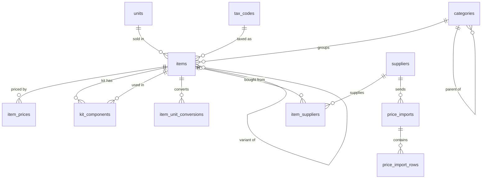
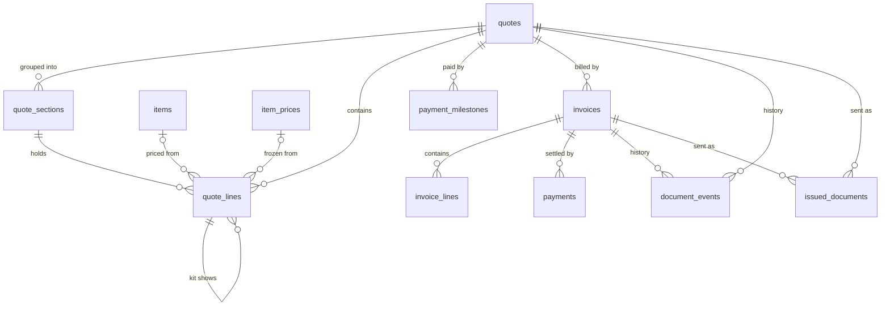

# Pricing engine v2

The target data model for Field's price book, quotes and invoices, and the
order in which we get there. It replaces the earlier catalogue and quote
design notes. The schema comes first; the UI is rebuilt on it, on Field's
design system (`DESIGN.md`).

Status: **in progress**. Phase 0b (tenancy) and phase 3 step 2 (issued
documents, see "Phase 3, step by step") are built, and so are legacy
codes as aliases (`item_code_aliases`, code retirement step 2) and the first
part of phase 1 (`kit_components`, `items.type`, `price()` and the
price-equality gate; see "Phases"), and quote rows carry the uid next to
every code (code retirement step 3, a boot data migration); nothing else here
is built yet unless it says so. Pricing configuration names items by uid
with the code as fallback (step 4). The price book clean-up (step 5) is a
boot data migration behind the price-equality gate, and MCP answers carry no
item codes (step 6; HTTP on request, by default once the app stops reading
them). Phase 3 step 3 parts one and two are built too: every quote version
is also written as `quotes`, `quote_sections` and `quote_lines` rows and
checked against what Field shows, and the quote PDF, the quote email's
totals, the job's totals and the API and MCP customer pricing are read from
those rows, while the files are still written alongside. Phase 3 step 4a
is built too (#27): every job's payment schedule, milestone invoices,
payments and receipts are also written as rows and checked against what was
issued; nothing reads them yet.

The owner's six decisions of 2026-10-12 (from the document audit) are
recorded where they change the design: credit notes ("Invoices and
payments"), invoice numbers ("Identity"), document bytes and issue versus
delivery ("`document_events` and `issued_documents`"), claim-line invoices
and milestone rules ("Invoices and payments"), and the order of work
("Phase 3, step by step").

## Principles

1. **The database is the engine.** Prices, kits, quotes and invoices are
   PostgreSQL rows with keys, constraints and history. No pricing lives in
   files (`quote-catalogs/*.json5`, `quote.json`, `rate-card.json`) or in
   code (rule modes, hardcoded recipes, rate cards).
2. **Standard trade-estimating model, nothing clever.** Price book → kits →
   quote lines → invoices, the way Fergus, simPRO, Tradify, ServiceM8 and Xero
   do it. Field drops everything that existed to turn a
   voice recording into a quote: rules, layers, compiled line items,
   attestation, transcripts and evidence packs.
3. **One way to compute a price.** Every number on screen, in a PDF or over
   the API comes from the same function over the same rows.
4. **History is append-only.** A price change is a new row, never an edit.
   What a quote said when it was sent is never recomputed.
5. **Freeze by value, link by id.** A quote line copies the price it used and
   keeps the id of the item and price row it came from, so a draft can show
   what changed and a sent quote never moves.
6. **Fail closed.** A missing, archived or unpriced item makes the line
   unpriced. It never becomes zero and never falls back to a default.

## Conventions

These apply to every table in this document.

### Names

- Tables are `snake_case` plural nouns: `items`, `item_prices`, `quote_lines`.
  A join or child table is `<parent>_<child>`: `kit_components`.
- Columns are `snake_case`. A foreign key is `<table singular>_uid`
  (`item_uid`, `quote_uid`). Booleans read as statements: `is_sold`,
  `is_default`. Timestamps end in `_at` and are `timestamptz`. Dates with no
  time end in `_on` (`valid_until_on`).
- Enumerations are `text` with a `CHECK` constraint, not Postgres enums, so
  adding a value is a plain migration.
- Money columns say what they are: `unit_cost`, `unit_sell`, `line_total`,
  `subtotal`, `tax_total`, `total`. Never `price` on its own.

### Tenancy: one database, many organisations

Field is built to serve more than one business from one PostgreSQL database.
Every tenant-owned table carries `org_uid` (FK `organizations`, `org_…`), and
isolation is enforced by the database, not by remembering a `WHERE`:

- **Row-level security** on every tenant table:
  `USING (org_uid = (select field_org_uid()))` and the same `WITH CHECK`,
  with `FORCE ROW LEVEL SECURITY` so the table owner is filtered too.
  `field_org_uid()` returns `current_setting('field.org_uid')` and raises
  when it is unset, so a query outside an organisation transaction fails
  instead of quietly seeing nothing; it is also the `org_uid` default. Each
  request runs in a transaction that starts with `SET LOCAL ROLE field_app`
  (a role without `BYPASSRLS` or DDL rights) and `SET LOCAL field.org_uid`
  from the signed-in user's membership. A query that forgets its filter sees
  nothing from other organisations, and an insert into the wrong one is
  refused. Boot refuses a database role on which this would not hold
  (`server/db/README.md` "Tenancy and row-level security").
- **Uniques are per organisation:** `(org_uid, lower(code))`,
  `(org_uid, number, version)`. Two businesses can both have `MAT-GRAVEL-20MM`
  and quote `EQ-2501-01`.
- **Foreign keys stay inside an organisation.** Child tables carry `org_uid`
  too, and composite keys (`(org_uid, item_uid)`) make a cross-tenant link
  impossible.
- **Shared reference data has no `org_uid`:** `units`, `unit_aliases`.
  `tax_codes` is per organisation, because tax depends on the country.
- `organizations` (`uid`, `name`, `slug`, `clerk_org_id`, `status`,
  `settings`) is the directory and has no RLS. `users` is the person;
  `org_memberships` (`org_uid`, `user_uid`, `role`: `owner`, `staff`;
  `status`: `active`, `pending`, `disabled`) is their place in an
  organisation, so one person can belong to several. `business_settings`
  becomes one row per organisation. Clerk Organizations map one-to-one onto
  `organizations`.
- Blobs (photos, PDFs) are scoped the same way: `job_files` and
  `issued_documents` carry `org_uid`, so a document is only reachable through
  its owner's rows.
- The default organisation (slug `embark`, created by migration
  `0005_tenancy`) is the first organisation.
  Existing rows were backfilled with its `org_uid` in phase 0b (migration `0005_tenancy`).
- Until jobs are rows (phase 3b), a deployment serves one organisation
  (`FIELD_ORG`, default `embark`): the data directory is not per
  organisation, so a signed-in person from another organisation is refused.
  The database layer is already multi-organisation.
- Not schema-per-tenant or database-per-tenant: those multiply every
  migration, backup and cross-tenant admin task, for isolation that RLS
  already gives at this scale.

### Identity: uid, code, number

Every row that something else points at has a **uid**: an opaque, immutable,
prefixed ULID (`itm_01JB8Z…`), generated by the server, never shown as a
label, never reused. It is the primary key and the only thing foreign keys
reference.

| Prefix | Entity |
| --- | --- |
| `itm_` | item (material, labour, equipment, subcontract, fee, kit) |
| `prc_` | item price row |
| `cat_` | category |
| `sup_` | supplier |
| `imp_` | supplier price import |
| `qte_` | quote |
| `qsc_` | quote section |
| `qln_` | quote line |
| `inv_` | invoice |
| `iln_` | invoice line |

Existing item uids are kept as they are; only new rows get prefixed ULIDs.

> **Direction change, 2026-10-12:** items have a name the
> operator chooses and a uid the system keeps; there is no second naming
> scheme. The price book no longer shows or asks for codes. Existing
> codes are legacy aliases (`item_code_aliases`, migration 0006): every code
> an item has had resolves to it, and codes no longer change. They stay until
> everything that looks items up by code resolves by uid (code retirement,
> steps 2 to 6 in "Status" above). The `TYPE-THING-SPEC` format below is
> superseded and kept only as the record of what was proposed.

A **code** is the human SKU an estimator types and reads: unique
(case-insensitive), editable, and shown everywhere an item is listed. Renaming
a code never breaks anything, because nothing links by code.

- Format: upper case letters, digits and single hyphens,
  `^[A-Z0-9]+(-[A-Z0-9]+)*$`, 3–32 characters. Enforced by a `CHECK`.
- Shape: `<TYPE>-<THING>[-<SPEC>]`, where the type prefix comes from the
  item's type:

  | Type | Prefix | Examples |
  | --- | --- | --- |
  | material | `MAT` | `MAT-GRAVEL-20MM`, `MAT-SLEEPER-KENSINGTON-200` |
  | labour | `LAB` | `LAB-GENERAL`, `LAB-OPERATOR` |
  | equipment | `EQP` | `EQP-EXCAVATOR-5T`, `EQP-COMPACTOR-500KG` |
  | subcontract | `SUB` | `SUB-PLUMBER`, `SUB-CONCRETE-PUMP` |
  | fee | `FEE` | `FEE-ADMIN`, `FEE-DISPOSAL-MIN` |
  | kit | `KIT` | `KIT-WALL-SLEEPER-1000`, `KIT-GRAVEL-SUPPLY-INSTALL` |

- The unit is not part of the code (`EQP-EXCAVATOR-5T`, not
  `EXCAVATOR-5T-HOUR`). The item's unit says how it is sold.
- No generated codes (`cat_143d45ed…`) and no `-copy` codes. A variant is its
  own item with its own code and a `variant_of_uid` link.

A **number** is a customer-facing document identifier, allocated once, never
reused, from a per-type sequence: quotes `EQ-YYMM-NN` (as today). Revisions
of a quote keep its number and add a version (`EQ-2501-03 v2`).

> **Decision, 2026-10-12:** invoice numbers are
> `INV-YYYY-MM-N`, from one sequence per organisation, allocated when the
> invoice is issued (`document_number_counters`). An invoice connected to a
> job carries the job number as a required reference. Numbers already issued
> (`EI-…`) stay as they are.

### Numbers, money and rounding

| What | Column type | Notes |
| --- | --- | --- |
| Unit cost | `numeric(12,4)` | Costs per small unit (per m, per kg) need more than cents. |
| Unit sell on a quote line | `numeric(12,4)` | Four decimals, so a historical line keeps the rate it was priced at. A line added from now on takes the rate rounded half-up to cents, so qty × rate always gives its total. |
| Line total | `numeric(12,2)` | The line's official amount. Round(qty × unit sell, 2), or for a line frozen from a document already issued, the amount it printed (see below). |
| Subtotal, tax, total | `numeric(12,2)` | Subtotal = sum of line totals. Tax = round(subtotal × rate, 2), once per tax rate, not per line. Total = subtotal + tax. |
| Quantity | `numeric(14,4)` | Displayed trimmed (`12`, `2.5`, `0.125`). |
| Markup, margin | `numeric(7,3)` percent | `25` means 25 %. |
| Conversion factor | `numeric(14,6)` | |

> **Decisions, 2026-10-12:**
>
> - **GST is worked out once on the subtotal, not per line.** Every quote
>   Field has sent did it this way, so the rows reproduce what customers
>   received. With one rate (all GST at 10 % today) that is
>   round(subtotal × 10 %, 2); with several, once per rate group. Per-line
>   GST could differ by a cent or more (three lines of $10.05: $3.02 on the
>   subtotal, $3.03 per line).
> - **The line total frozen as printed is the official amount.** Quote lines
>   carry their rate to four decimals, and a historical version reproduces
>   exactly. A line whose qty × rate does not give the total it printed (a
>   three-decimal catalogue sell the PDF rounded differently, a fixed price
>   no whole-cent rate reaches) keeps that total, marked
>   `line_total_source = 'printed'` with the reason in `line_total_reason`.
>   Every other line is `computed`, and the database checks that it equals
>   round(qty × rate, 2). Rounding catalogue sells with more than two
>   decimals is a separate catalogue decision; catalogue data is not changed.

- One currency (AUD), held on the quote and invoice row, so the model does not
  have to change if another is ever needed.
- All amounts are stored **excluding GST**. Tax comes from the line's tax
  code.
- Display rule for every screen and PDF: money shows 2 decimals; unit cost may
  show 4 only in the item editor's cost field. The grid shows `$1,654.56`,
  never `$1,654.5632`.
- **Markup** is (sell − cost) ÷ cost. **Margin** is (sell − cost) ÷ sell. The
  grid labels them exactly that way and never mixes them.

### Lifecycle and history

- Rows that something can point at are never hard-deleted once used. They
  have `status` (`active`, `archived`, and `draft` where it makes sense) and
  `archived_at`. Unused rows can be deleted.
- Every table has `created_at` and `created_by`. Mutable tables also have
  `updated_at`, `updated_by` and an integer `version` for optimistic
  concurrency (`expectedVersion` / `If-Match`).
- `audit_log` records field-level changes to every catalogue and document
  table (who, when, old → new, reason). It replaces `catalog_history`.

## Catalogue

### `items`

One row per thing the business prices.

| Column | Type | Notes |
| --- | --- | --- |
| `uid` | text PK | `itm_…` |
| `code` | text, unique lower() | See Codes |
| `name` | text | What estimators call it: "20mm gravel" |
| `description` | text null | Customer-facing wording used on quotes when set |
| `notes` | text null | Internal notes for estimators; never printed (built, migration 0007) |
| `type` | text | `material`, `labour`, `equipment`, `subcontract`, `fee`, `kit` |
| `category_uid` | FK categories | The trade or work section: required |
| `unit_code` | FK units | How it is sold |
| `tax_code` | FK tax_codes | Default `GST` |
| `pricing_method` | text | `markup`, `fixed` or `rollup` (kits only). See Pricing |
| `is_sold` | boolean | Shown in the quote picker. Internal components are `false` |
| `variant_of_uid` | FK items null | Replaces `-copy` |
| `status` | text | `active`, `draft`, `archived` |
| `version`, timestamps, `*_by` | | |

Dropped from today's table: `kind` (becomes `type`, 0 of 174 set today),
`visibility` (becomes `is_sold`), free-text `category` (becomes
`category_uid`), `tags` (0 used), `price_reference`, `unit_label` (alias text
moves to `unit_aliases` display), `cost_mode` and `sell_mode` (become
`pricing_method`), `pricing_basis` (already an `item_unit_conversions` row).

### `categories`

The work sections a quote is grouped by, not what an item is made of. What it
*is* (material, labour, equipment) is `items.type`, so the two never compete
for the same field the way "Materials" and "Walls" do today.

| Column | Type | Notes |
| --- | --- | --- |
| `uid` | text PK | `cat_…` |
| `name` | text, unique lower() | "Retaining walls" |
| `parent_uid` | FK null | At most two levels |
| `sort_order` | int | Order on quotes and in the grid |
| `status` | text | `active`, `archived` |

Proposed starting set (for the operator to confirm): Site & admin,
Earthworks, Retaining walls, Drainage, Concrete & paving, Landscaping (Lawn,
Irrigation, Planting), Demolition & disposal, Haulage.

### `units`, `unit_aliases`, `item_unit_conversions`, `tax_codes`

Kept as built: typed units with a dimension and base factor, aliases
for input, item-specific conversions (1 m³ gravel = 1.6 t), and tax codes
(`GST` 10 %, `GST_FREE`, `INPUT_TAXED`).

### `item_prices` (price history)

Append-only and effective-dated: kept as built, with names tightened.

| Column | Type | Notes |
| --- | --- | --- |
| `uid` | text PK | `prc_…` (today an identity id; quote lines record it) |
| `item_uid` | FK items | |
| `unit_cost` | numeric(12,4) null | Null for a rollup kit |
| `markup_pct` | numeric(7,3) null | Used when `pricing_method = markup` |
| `unit_sell` | numeric(12,2) null | Used when `pricing_method = fixed` |
| `effective_from` | timestamptz | |
| `source` | text | `manual`, `import`, `bulk`, `migration` |
| `source_ref` | text null | Import or bulk batch uid |
| `reason` | text null | |
| `created_at`, `created_by` | | |

- The current price of an item is its latest row with
  `effective_from <= now()` (ties: latest `created_at`). A future-dated row is
  a scheduled price.
- Rows are never updated or deleted by the app. A grant-level rule
  (`REVOKE UPDATE, DELETE`) or trigger enforces it.
- The price at any past moment is a query, not a reconstruction:
  `price_at(item_uid, at)`. A kit's past price is its components' prices at
  that moment.

### Pricing

One function computes every price: `price(item, at)` →
`{ unit_cost, unit_sell, markup_pct, margin_pct, price_uid, problems }`.

| `pricing_method` | Cost | Sell |
| --- | --- | --- |
| `markup` | the price row's `unit_cost` | round(cost × (1 + markup_pct/100), 2) |
| `fixed` | the price row's `unit_cost` | the price row's `unit_sell` |
| `rollup` (kits) | Σ component qty × component cost | Σ component qty × component sell, rounded to cents |

A kit may also be `markup` (sell = rolled-up cost × markup) or `fixed` (a set
sell price, cost still rolled up). Its cost always rolls up.

Each component counts in its own unit, converted to the component item's unit
through `units` or `item_unit_conversions`. A conversion that does not exist
is a save-time error (`UNIT_MISMATCH`), not a pricing-time surprise. An
archived, missing or unpriced component makes the kit unpriced, never zero.

### `kit_components`

One table for kits. It replaces `item_components` and the five empty
`assembly_*` tables, and recipes move here out of
`quote-catalogs/embark-default.json5`.

| Column | Type | Notes |
| --- | --- | --- |
| `kit_uid` | FK items (type = kit) | |
| `component_uid` | FK items, restrict | Any type, including another kit |
| `quantity` | numeric(14,4) | Per one unit of the kit: a kit sold per m² lists what one m² needs |
| `unit_code` | FK units | The unit the quantity is in |
| `waste_pct` | numeric(7,3) default 0 | |
| `show_on_quote` | boolean | Whether the component appears under the kit line on the customer document |
| `sort_order` | int | |

- No cycles (checked on save), no self-reference, and at most one row per
  component per kit.
- Measured assemblies with formulas (`ceil(length / 2.4)`) are not part of
  v1. Kits priced per unit cover hand-built quotes, and the expression
  language stays available if a real case needs it. The retaining-wall engine
  is covered under Quotes.

### Suppliers and imports

Kept as built: `suppliers`, `item_suppliers` (supplier code, pack
quantity, default supplier) and staged `price_imports` / `price_import_rows`
with a diff before apply. They are empty today, so the UI hides them until a
supplier exists rather than showing empty columns.

## Quotes and invoices

Today a quote is about a dozen files per job. `quote.json` is built by the
voice-recording engine, even for a hand-built quote:
`createManualJob` writes a stand-in transcript and evidence pack, and every
save reruns the full build. Prices on a row can come from five override
layers. Totals and GST are computed in seven places, and GST comes from a
json5 file rather than the item's tax code. v2 makes quotes and invoices
ordinary rows.

### `quotes`

One row per quote version. A revision is a new row with the same `number`
and the next `version`. The previous row becomes `superseded`.

| Column | Type | Notes |
| --- | --- | --- |
| `uid` | text PK | `qte_…` |
| `job_id` | text | The job (jobs stay in the job store for now) |
| `number`, `version` | text, int | `EQ-2501-03`, 2. Unique together |
| `status` | text | `draft`, `sent`, `accepted`, `declined`, `superseded`, `void` |
| `title`, `scope_text`, `terms_text` | text | Customer-facing wording |
| `customer` | jsonb | Name, address, email and phone, frozen at send |
| `currency` | text | `AUD` |
| `valid_until_on` | date | |
| `subtotal`, `tax_total`, `total` | numeric(12,2) | Computed by the one totals function. Stored when sent |
| `tax_total_source`, `tax_total_reason` | text | `computed`, or `printed` with the reason (below) |
| `catalog_version` | bigint | The catalogue version the lines were last priced against |
| `sent_at`, `accepted_at` | timestamptz | |
| `version_lock` | int | Optimistic concurrency (named so it doesn't clash with `version`) |

**Built (#6, migration `0010_quote_rows`), with these differences:**

- A version is unique per job, `(org_uid, job_id, version)`, not per
  number. The audit found quote numbers that collide across jobs, so
  `(number, version)` is only indexed until numbers come from
  `document_number_counters`. The backfill lists any number two jobs share.
- `issued_document_uid` links the issued document the version was
  sent as. `source_digest` is a hash of the files the rows were mapped from,
  so an unchanged version is not rewritten.
- `terms_text` and `catalog_version` are null for rows mapped from files:
  terms print from the business settings, and quote.json does not record the
  catalogue version.
- Totals are stored on every version, not only when sent, and are always
  `quoteTotals` over the lines being written.
- **GST as printed, in one case only.** Until GST was rounded exactly (#2),
  the renderer worked it out in binary floating point. When the exact tax
  falls on half a cent ($21.15 at 10 % is $2.115), a PDF could print a cent
  less than exact rounding ($2.11, not $2.12): 3,277 of the first 2,000,000
  possible subtotals. Field now shows $2.12 for such a quote. A sent version
  whose sent copy printed the lower GST keeps it, with
  `tax_total_source = 'printed'` and the reason; its subtotal must still
  equal what Field shows. The service refuses a printed GST in any other
  case, and new quotes always compute it.
- **Sent never changes, in the database.** A quote is frozen once it is
  `sent`, `accepted` or `declined`, or has a `sent_at`. Triggers then refuse
  inserting, updating or deleting its sections and lines, changing its
  number, money, customer or wording, setting it back to `draft`, replacing
  its issued document, and deleting it, for the table owner too. Its status
  may still move on (`superseded`, `accepted`, `void`).

### `quote_sections`

The groups the customer sees ("Retaining wall", "Drainage"). This replaces
organizer group nodes. Sections are flat, ordered and optionally subtotalled.

`uid` (`qsc_…`), `quote_uid`, `title`, `sort_order`, `show_subtotal`
(built, with `source_node_id`, the organizer group it came from).

### `quote_lines`

Every line stores the values it prints, whether or not it came from the
catalogue.

| Column | Type | Notes |
| --- | --- | --- |
| `uid` | text PK | `qln_…` |
| `quote_uid`, `section_uid` | FK | |
| `parent_line_uid` | FK null | A kit component shown under its kit line |
| `sort_order` | int | |
| `line_type` | text | `item` (from the catalogue), `custom` (typed in), `component` (under a kit), `note` (text only) |
| `item_uid` | FK items null | The catalogue item, if any |
| `price_uid` | FK item_prices null | The price row used. Null for a rollup kit (see `price_key`) |
| `price_key` | text null | Changes when anything behind a kit's price changes, so a draft can tell the kit moved |
| `code`, `name`, `description` | text | Frozen copies. The description prints |
| `quantity` | numeric(14,4) | |
| `unit_code` | FK units | |
| `unit_cost`, `unit_sell` | numeric(12,4), (12,4) | Copied from the catalogue when added (the sell rounded to cents), or typed |
| `is_price_override` | boolean | The estimator changed the catalogue's sell. `override_reason` text |
| `tax_code`, `tax_rate` | text, numeric | From the item. Frozen |
| `line_total` | numeric(12,2) | The official amount: round(qty × unit_sell, 2), or as printed |
| `line_total_source`, `line_total_reason` | text | `computed` (checked by the database), or `printed` with the reason |
| `is_optional`, `is_selected` | boolean | For options the customer can choose. Unused today, so it can come later |

Rules:

- **Add from catalogue:** the server copies the item's current price into the
  line and records `item_uid`, `price_uid` / `price_key`. A kit can go on as
  one line, or as one line with `component` children for display. The kit
  line carries the price either way, so component lines never add to the
  total twice.
- **Draft refresh:** the server compares each line's `price_uid` /
  `price_key` with the item's current price and lists the lines that changed
  (old → new). The estimator applies all, some or none. Lines with
  `is_price_override` are listed but never changed silently. This replaces
  the organizer's catalogue diff, and closes the gap where a kit's frozen
  price went stale, by construction.
- **Totals:** one function, `quoteTotals(lines)`. It sums `line_total` over
  priced, selected lines for the subtotal, works GST out once on that
  subtotal (round(subtotal × rate, 2) per tax rate, not per line), and adds
  them for `total`. The PDF, the email, the list view and the API all read
  it. There is no per-line tax: it would not add up to the GST charged.
- **New lines round their rate.** A line added from now on takes the rate
  rounded to cents, so qty × rate always gives its total and the line is
  `computed`. Only lines frozen from documents already issued are `printed`.
- **Send freezes.** Sending sets `status = sent` and stores the totals.
  After that, a trigger refuses any `UPDATE` or `DELETE` on the quote's lines
  and sections. To change a sent quote, create a new version, which copies
  its lines into a new draft. Sending needs no lineage or attestation check:
  every line already holds its own frozen price, so a quote can no longer be
  refused for missing line-item lineage.

**Built (#6), with these differences:**

- `section_uid` is null for a line outside any section (a top-level row).
  `parent_line_uid` also puts a row under a `note` heading, not only a
  component under its kit.
- `is_optional` and `is_selected` are built, because today's "listed only"
  rows are exactly that: printed with a price, not charged.
- `item_uid`, `price_uid` and `price_key` are not foreign keys. The
  catalogue can still delete an item a quote used, and a sent line must keep
  naming it. `price_uid` holds today's `item_prices` id.
- `unit_code` is text, not a foreign key: quote rows carry units the
  `units` table may not have.
- `tax_code` is `GST` at the quote's rate: today one rate (the catalogue
  file's `gstRate`) applies to the whole quote.
- `line_tax` is not built: GST is worked out on the subtotal (decided
  2026-10-12), so a per-line tax would not add up to what was charged.
- `line_total_source` and `line_total_reason` record how a line's total was
  set (see "Numbers, money and rounding").

### Invoices and payments

Milestone invoicing is used on 51 of 65 jobs, so it gets proper tables.

> **Decisions, 2026-10-12:**
>
> - **An issued invoice is never revised in place.** It is corrected with a
>   credit (adjustment) note against it, then a new invoice. Today's in-place
>   revisions (`issuedRevision`, `revisionHistory`, the `-R2` and `-R3`
>   numbers, `reviseJobMilestoneInvoice`) migrate as a credit note plus a
>   new invoice (step 4b).
> - **Numbers:** `INV-YYYY-MM-N`, one sequence per organisation, allocated
>   in the issue transaction, with the job number as a required reference
>   (see "Identity"). Numbers already issued (`EI-…-M<n>`, `-R<k>`, `ER-…`
>   receipts) stay exactly as issued.
> - **Bytes** go in `document_blobs`, with the R2 replica (#12).
> - **A document is issued when it is finalised.** Email is delivery,
>   tracked separately (`document_events`).
> - **Milestone invoices show claim lines**, one per milestone, each
>   referencing the quote ("Deposit, 50 % of EQ-2501-03 v2"), not the full
>   quote schedule.
> - **Milestone defaults come from account rules by contract value,**
>   entered as data and never hard-coded, with per-job overrides that are
>   visibly marked. A rule can cap a milestone, and each cap either warns or
>   blocks issuing. An example rule set for a South Australian builder: a
>   deposit of at most $1,000 under a $20,000 contract value, and at most
>   5 % from $20,000.
> - **GST is worked out once on the subtotal per tax rate,** in integer
>   cents, half up (`shared/money.js` `taxOnSubtotal`). Money columns follow
>   "Numbers, money and rounding".

- `payment_milestones`: `uid`, `quote_uid`, `label` ("Deposit",
  "On completion"), `percent` or `amount`, `sort_order`. Defaults come from
  the account's rules.
- `invoices`: `uid` (`inv_…`), `number` (`INV-YYYY-MM-N`), `quote_uid`,
  `job_id` (the required reference), `milestone_uid` null, `kind`
  (`deposit`, `progress`, `final`, `variation`), `status` (`draft`,
  `issued`, `paid`, `void`), `issued_on`, `due_on`, `subtotal`,
  `tax_total`, `total`, `amount_paid`. An issued invoice is frozen the same
  way a sent quote is, and is corrected only by a credit note.
- `credit_notes`: an adjustment against one issued invoice, with its own
  number, lines and issued document (`document_type` `credit_note`).
- `invoice_lines`: the same shape as `quote_lines` (`iln_…`). A milestone
  invoice has claim lines, one per milestone ("40 % deposit on EQ-2501-03
  v2"), each pointing at the quote.
- `payments`: `uid`, `invoice_uid`, `amount`, `paid_on`, `method`,
  `reference`. Receipts are generated from payments.

**Built (step 4a, #27, migration `0013_invoice_rows`), with these
differences:**

- `payment_milestones` belongs to the job (`job_id`, `sort_order` = today's
  milestone index) and points at the quote version it bills (`quote_uid`,
  null while that version has no rows). It keeps `due_days`, and
  `is_default_schedule` is ready for step 4c. Nothing today is known to
  come from account rules, so it is false.
- `invoices` keep their numbers as issued (`EI-…-M<n>`, `EI-…-M<n>-R<k>`).
  `INV-YYYY-MM-N` arrives with step 4b. `status` also has `credited`: a
  revision that was superseded in place is its own row, `credited`, and its
  successor names it in `supersedes_invoice_uid`, until step 4b adds the
  credit note that corrects it. A revision returned to draft (unsent, or
  marked unpaid) is `void`; re-issuing the same content restores it under
  the same number. `revision`, `quote_version` (with
  `quote_version_inferred` for an invoice from before revisions were
  tracked), `issued_at`, `issued_document_uid` and `reference` (the job
  number; required from step 4b) are columns. `tax_total_source` works as
  on quotes: a milestone's GST is its share of the quote's GST, so where
  that differs from GST on its own subtotal the invoice keeps the GST it was
  issued with, `printed`, with the reason.
- `invoice_lines` hold what the invoice PDF claims: one `claim` line, the
  milestone's share of the quote ex GST, against the quote. Today's PDF also
  prints the quote's schedule, which is the quote's rows.
- `credit_notes` and `credit_note_lines` exist with their checks and
  triggers. Nothing writes them until step 4b.
- `payments` belong to the invoice they were recorded against
  (`sourceInvoiceNumber`), keep `voided_at`, `void_reason` and
  `voided_by`, and are never deleted. A payment the files drop ("mark
  unpaid" clears them) is voided. An invoice's `amount_paid` is the sum of
  its active payments.
- `receipts` are one per payment. Today a receipt is issued for a milestone
  once it is paid in full. Its row is for the payment that cleared it, with
  the amount it acknowledges, and is voided if that payment is.
- **Issued never changes, in the database.** Once an invoice or credit note
  has an issue time, triggers refuse any change to its number, money, lines
  or issue time, setting it back to draft, and deleting it, for the table
  owner too. Its status, amount paid, due date, kind and note may change,
  and links missing when it was written are filled once. Payments may only
  be voided, once; receipts may only be voided. `TRUNCATE` is always
  refused.

### `document_events` and `issued_documents`

**Built (migration `0009_issued_documents`).** Every document a
customer was issued has its own uid, its exact bytes and an append-only
history. In this step the job files are still the source of truth: the
tables are filled alongside them and read only by the by-uid routes.

- `document_blobs`: the bytes. `sha256` (primary key per organisation),
  `byte_length`, `content_type`, `bytes` (bytea), `created_at`. The database
  checks that the hash matches the bytes. This is not durable storage's
  `field_blobs`: that table mirrors the data directory, has no organisation
  and is retired in phase 3b.
- `issued_documents`: one row per document as issued. `uid` (`doc_…`),
  `job_id`, `document_type` (`quote`, `invoice`, `receipt`, `credit_note`),
  `number` as printed (`EQ-2501-01 v1`, `EI-2501-01-M1`, `EI-2501-01-M1-R2`,
  `ER-2501-01-M1`; a quote's number carries its version, because the quote
  number alone is shared by every version), `quote_version`, `revision`,
  `issued_at`, `issued_by`, `pdf_sha256` (a foreign key into
  `document_blobs`), `source` (`live`, `ledger-backfill`,
  `invoice-revision-backfill`, `legacy-sent-attachment`,
  `legacy-stored-version`) and `details` (frozen business, customer and money
  details where they were known). `(org_uid, document_type, number)` is
  unique.
- `document_events`: `uid` (`dev_…`), `issued_document_uid` (null for an
  event with no issued document, such as an email that failed before its
  document was issued), `job_id`, `document_type`, `event` (`created`,
  `issued`, `emailed`, `email_failed`, `paid`, `voided`, `credited`), `at`,
  `by`, `data` (recipients, Gmail message and thread ids, the delivery
  attempt) and an `idempotency_key`, so a retried write adds nothing.
- `document_number_counters`: `(org_uid, document_type, period)` and
  `last_value`, for allocating numbers in the database in phase 3. Nothing
  uses it yet.

Rules:

- **Issued once, never changed.** Triggers refuse `UPDATE`, `DELETE` and
  `TRUNCATE` on blobs and events, and on every `issued_documents` column
  except `details`, for the table owner too. `field_app` is granted no more.
- **A document is issued when it is finalised; email is delivery** (decided
  2026-10-12). The `issued` event and the `emailed` event are separate
  facts. Step 2 records both and does not change when today's code considers
  something issued: a quote is issued when it is emailed, an invoice revision
  when it is frozen. Issuing at finalisation arrives with documents built
  from rows.
- **Same number, same bytes, or refused.** Recording a number again with the
  same bytes is a no-op. A resend that renders the PDF again keeps the issued
  document as it was and stores the bytes that were sent with its `emailed`
  event (`bytesMatchIssued: false`).
- **The byte store is an interface.** `server/documents/blob-store.js` is the
  only code that touches `document_blobs`, through `put(bytes) → sha256`
  and `get(sha256) → bytes`.
- **A locked R2 replica (#12, built, migration `0012_document_replicas`).**
  PostgreSQL stays the store of record. With `FIELD_DOCUMENT_REPLICA=r2`,
  each blob is copied after its issue transaction commits to a Cloudflare R2
  bucket with a bucket lock, at `<org_uid>/<sha256>`
  (`server/documents/replicator.js`). The copy is create-only: HEAD first, an
  object with the same size and hash counts as done, different bytes are an
  integrity alarm, never an overwrite. A scheduler tick retries with backoff
  and backfills older blobs a few a minute. `document_blob_replicas` records
  `r2_replicated_at`, attempts and the last error code per blob. Reads stay on
  PostgreSQL and fall back to R2, hash-checked, only when PostgreSQL cannot
  give the bytes. `npm run documents:verify-r2` checks every issued document
  is in the bucket with its hash. Operating it: `docs/REPLIT.md` "Issued
  documents in R2".

These tables replace `quote-issuance.json` and its `issued-documents/`
folder, the issued-PDF fields on `milestone-invoices/state.json`, the
legacy sent-quote lookup, and later `quote-lifecycle.json`,
`sent-emails.jsonl` and the `quote_snapshots` table. How they are filled
today, and what moves next, is under Phases.

### Business settings

`business_settings` (one row) holds the business name, ABN, bank details,
default terms, quote validity days and numbering prefixes. All of these come
out of `quote-catalogs/embark-default.json5`, whose `gstRate` is replaced by
item tax codes.

## Everything else moves to tables too

Quotes are not the only thing kept as files. Jobs, invoices, logs, the email
outbox and tokens live as JSON files in the data directory, with a SQLite
`field.db` as the job index and notes store. Since the Replit cutover all of
it is mirrored into PostgreSQL as opaque blobs (`field_files`,
`field_sqlite_images`). That makes the files durable, but they still can't be
queried, have no foreign keys, are saved several files at a time rather than
in one transaction, and have no field-level history. The end state is
**every record a row, and files only for documents**.

| Today (file) | v2 table |
| --- | --- |
| `meta.json` (job, customer and contact fields, stage, cached totals) | `jobs`, `customers`, `contacts`. Totals are read from `quotes`, never cached on the job |
| `field.db` `jobs` index | dropped: `jobs` is the index |
| `field.db` `notes_ledger`, `structured-notes.json`, `notes.json` | `job_notes` |
| `job-state/activity.jsonl`, `events.jsonl`, `details.json`, `gaps.json`, `tasks.json` | `job_events` (activity), with the remaining fields on `jobs` |
| `quote*.json`, `quote-versions/`, `quote-lifecycle.json`, `quote-issuance.json` | `quotes`, `quote_sections`, `quote_lines`, `document_events`, `issued_documents` (above) |
| `milestone-invoices/state.json` | `payment_milestones`, `invoices`, `invoice_lines`, `payments` (above) |
| `sent-emails.jsonl`, `quote-delivery-outbox.json`, scheduled emails | `email_messages` (one row per email: status `scheduled`, `sending`, `sent`, `failed`; recipients, Gmail ids), linked to `document_events` |
| `email-templates.json` | `email_templates` |
| `gmail-oauth-users.json` | `oauth_tokens`, with the refresh token encrypted at rest |
| `users.json` | `users` (done, migration `0002_field_users`) |
| `config.json` business fields | `business_settings` (above). Secrets stay in Replit Secrets |
| Capture-era files (`transcript*.json`, `evidence-pack.json`, `evidence-index.json`, `ingestion-ledger.json`, `quote-inputs.json`, `quote-context.json`, `site-conditions.json`, wall and Moasure files) | not migrated. Kept read-only with the job's archive |

What stays a file: photos, uploaded attachments and every PDF a customer
received. Each is stored once by SHA-256 and referenced by a row
(`job_files`, `issued_documents`). Issued PDFs are in `document_blobs`, a
table of their own behind a two-call interface, not in durable storage's
`field_blobs` (see `document_events` and `issued_documents`). Writes go through one service per
aggregate (job, quote, invoice, email) in a single database transaction, and
every change is recorded in `audit_log`. Once nothing reads the data
directory, durable storage's file mirror (`server/storage/`) and the
per-job generation locks are retired.

## What goes away

Hand-built quotes run through all of this today, and none of it is needed once
quotes are rows. The figures are approximate lines of code when this plan
was written.

| Remove | What it is | Size |
| --- | --- | --- |
| Capture stand-ins | `createManualJob` writing a fake `transcript.json`, `evidence-pack.json` and `quote-inputs.json`, and the rebuild-on-every-save they trigger | – |
| Evidence and ingestion stack | evidence pack, ingestion ledger, evidence index, stale detection, clarification notes, baseline-scope reconcile, breakdown source, version context, review state and projection, job state and gaps, quote proof and trace | ~4.5k |
| Rules engine | `generate-evidence-quote`, `quote-quantity-rules`, `quote-commercial-compiler`, execution estimator, internal breakdown, quote catalogs, catalogue overlay (`catalog-pricing.js` authority pricing), commercial adjustments, recipe pricing, assembly modes | ~10.5k |
| Rule files | the rules, `quantityRules`, assemblies and execution profile in `quote-catalogs/embark-default.json5`. The business profile moves to `business_settings` | 1k lines of json5 |
| Pricing attestation | `quote-pricing-attestation.js`, `quote-pricing-visibility.js`. This is what refuses quotes for missing line-item lineage | ~0.6k |
| Retaining-wall engine | bay model, rate card, steel picker, wall zones and render. Walls are already priced as kits per bay in the price book (37 "Walls" items). 2 historical jobs used zones, and their sent PDFs are kept | ~4.9k |
| Moasure import | used on 6 historical jobs. Measurement entry becomes plain quantities | ~0.6k |
| Quote files | `quote.json`, `quote.md`, `quote-overrides.json`, `quote-breakdown-source.json`, `quote-versions/`, the organizer tree, `quote_snapshots` | – |
| Dead code | `server/db/job-backfill.js`, `generate-landscaping-quote.js` | ~1.6k |
| Client | evidence player, gap, assumption, execution and soil sheets, breakdown view, review sheet, measurement panel, models overlay, health bar. The second catalogue editor (`QuoteCatalogPanel` and `CatalogItemAdminForm`, inside the 14k-line `quote-presentation-sheet.tsx`) | ~7.5k + most of 14k |
| MCP | `field_quote_recalculate`, `field_quote_catalog_list`, raw `field_quote_draft_update`. Replaced by typed quote-line tools | – |

That is roughly 30k lines removed, against perhaps 5k of new tables, services and
tests.

## Moving today's data

Production on 2026-10-11 has 174 active catalogue items and 57 jobs (65 job
folders) with 541 catalogue-linked rows, 611 manual rows, 84 groups, and 51
jobs with milestone state (6 issued invoices). The catalogue data problems
behind the price-book noise:

| Problem | Count | v2 fix |
| --- | --- | --- |
| Generated codes (`cat_143d45ed…`) | 102 of 174 | Proposed codes from type + name. The operator reviews the list before it is applied |
| `-copy` codes | 14 | Renamed, with `variant_of_uid` set where the copy is a variant |
| Lower-case or `__` codes | 27 | Upper-cased into the code format |
| `kind` / type not set | 174 of 174 | Proposed from the current category and name, reviewed |
| Free-text category mixing type and trade | 13 values, 19 blank | Mapped to the new category set. "Materials", "Labour", "Machinery" and "Goods" become types |
| Sells with more than 2 decimals | 84 price rows | Rounded to cents in a new `migration` price row, so the old value stays in history |
| Tags, descriptions, suppliers | 0 used | Hidden until used |

Rules for the migration:

- **No price values change** except rounding sells to cents, which is
  recorded. Codes, types and categories are applied from a proposal file that
  the operator approves first: proposed changes are written to a CSV, reviewed, then
  applied in one transaction behind a point-in-time restore point.
- Uids never change, so every existing link survives.
- **Quotes:** every job's current quote and each version becomes `quotes`,
  `quote_sections` and `quote_lines` rows:
  - Organizer groups become sections.
  - Organizer rows become lines, with their frozen values as printed.
  - Catalogue links become `item_uid` and `price_uid`.
  - Engine lines (10 jobs) become `custom` lines.
  - Sent versions arrive as `sent` with their stored PDF in
    `issued_documents`.

  The migration verifies, per quote, that the new totals equal the totals on
  the PDF the customer received, to the cent. Any mismatch is reported and
  refuses the migration. Built as `scripts/backfill-quote-rows.js` (#6;
  see "Phase 3, step by step"), which refuses per job, and run at boot as a
  data migration (#36).
- Milestone state becomes `payment_milestones`, and issued revisions become
  issued `invoices` with their stored PDFs. Built as
  `scripts/backfill-invoice-rows.js` (#27), which verifies every issued
  invoice against its PDF and refuses per job, and run at boot as a data
  migration (#36).
- The old files stay read-only in the job folder until the watch period ends.

## Price book UI

Built on Field's design system (`DESIGN.md`), not inline styles. The price
book at `/pricing` (`client/src/features/catalogue/`) uses the `fx-`
primitives; this plan was written against the older kit in
`client/src/components/field/`, whose parts it names:
- the grid is `DataTable`, `HeaderCell`, `Row` and `Cell` (`numeric`,
  `mono`), with `formatMoney` (always 2 decimals) and `formatPercent`;
- the item pane is a `docked` `SideDrawer`;
- the filters are `SegmentedControl`, `Select`, `FilterChip` and
  `SearchField`;
- statuses are `StatusBadge`.

Light and dark mode both come from the kit's tokens. Filled controls use
`--t-primary` and `--t-on-primary`, and screens never hard-code a colour.

What is wrong today, from the price book at `/pricing`:

- **Engine noise in every row:** generated codes, `kit-6` badges, `+ tags`
  under every name, mode words (`fixed`, `kit`) in the Markup column, and
  empty Supplier and Variant columns.
- **Inconsistent numbers:** `$1,654.5632` next to `$132.00`, and margin
  without a clear basis.
- **Categories:** a strip of free-text chips that mixes types and trades,
  plus an "Uncategorised" bucket.
- **Two catalogue editors:** the Price book tab, and an Item editor tab that
  embeds the quote sheet's catalogue panel.

The v2 price book:

1. **One screen, two panes.** The grid on the left; selecting a row opens the
   item in a right-hand drawer. There is no separate editor tab, and the
   search box and filters stay put while you drill into a kit.
2. **Grid columns** (default): Name · Type · Unit · Cost · Sell ·
   Markup % · Margin %. Optional: Category, Supplier, Last changed, Status.
   Money is right-aligned, monospaced, always 2 decimals. Kits show a small
   kit icon after the name, not a text badge. Empty optional columns are
   hidden, not filled with dashes.
3. **Filters:** a segmented Type control (All · Materials · Labour ·
   Equipment · Subcontract · Fees · Kits), a Category select (the trade
   hierarchy) and Status (Active · Draft · Archived), plus one search box over
   name, category, tags and supplier code (legacy codes still match,
   unseen). The category chip strip goes.
4. **Item drawer:**
   - Header: name, type, unit, category.
   - Pricing: cost, method (markup or fixed), sell, markup and margin.
     Editing shows the before → after.
   - Kit components: an inline table with quantity and unit, the component's
     sell and the extended amount, plus a search to add components without
     leaving the drawer.
   - "Used in": kits, and draft and sent quotes, so an operator sees what
     depends on an item before deleting it.
   - Price history: a dated list, and the point-in-time price.
5. **Editing keeps your place:** renaming does not jump the row (it re-sorts
   on blur, then scrolls the row into view), and a kit's numbers refresh as
   soon as a component changes.
6. **Bulk actions** on a selection: set markup, adjust cost or sell by %,
   change category, archive. Each shows a preview diff before applying
   (built).
7. **Quote builder picker:** the same search component, dockable instead of
   a fixed popup. Adding a line shows its frozen price, and a draft
   shows a "N prices changed" banner with the diff.

## Phases

Each phase is one or more PRs. Each ends with production working and the
offline quote and invoice proof passing (`npm run qa:quote-invoice-proof`).

| Phase | What | Done when |
| --- | --- | --- |
| 0. Watch the attestation | On 2026-10-11, 8 of the 9 live drafts are sendable; the ninth is an empty test job. Fix the attestation only if a real quote is refused for missing line-item lineage before phase 4 removes it | No real quote refused |
| 0b. Tenancy foundation | `organizations`, `org_memberships`, `org_uid` and RLS on the existing catalogue, user and snapshot tables; a request-scoped transaction helper that sets `field.org_uid`; an RLS test that proves cross-tenant reads and writes fail | Two-org test suite passes |
| 1. Catalogue schema | Migration: `type`, `category_uid`, `pricing_method`, `is_sold`, code `CHECK`, money precision, `kit_components` (from `item_components`), recipes out of json5, drop the empty `assembly_*` tables and unused columns, `audit_log`, `business_settings`. One `price()` function | Catalogue tests green. Every active item prices identically before and after, except cents rounding, which is recorded |
| 2. Catalogue clean-up | Generate the code, type and category proposal CSV. The operator reviews it. Apply it | 0 generated or `-copy` codes, 0 untyped, 0 uncategorised |
| 3. Quote tables | `quotes`, `quote_sections`, `quote_lines`, invoices, payments, events, issued documents (events, issued documents, quote rows and invoice rows are built: steps 2, 3 and 4a below). The quote service and one `quoteTotals`. Migrate all jobs, verified against sent PDFs to the cent | Every quote's totals match its PDF. New quotes are built only from rows |
| 3b. Jobs and the rest | `jobs`, `customers`, `contacts`, `job_notes`, `job_events`, `email_messages`, `email_templates`, `oauth_tokens`, `job_files`; migrate and verify every job; retire `field.db` and the file mirror | Nothing reads `DATA_DIR` except blobs |
| 4. Strip the engine | Delete the removals list. Quote builder, PDF and email read only the new tables | ~30k lines gone; the proof passes |
| 5. UI | Price book and drawer, then the quote builder, on Field's design system | The editing behaviour in "Price book UI" works; one catalogue editor |
| 6. API and MCP | Typed catalogue and quote-line operations for external AI | Contract tests |

Phases 1–2 and 3–4 can overlap. 5 builds on Field's design system
(`DESIGN.md`).

### Phase 1 as built (part one)

Built (migration 0007, `server/catalog/price.js`):

- `kit_components` (was `item_components`; `kit_uid`, `component_uid`).
- `items.type` with its check; kits typed from their components. Item rows
  carry `type`, `is_sold` and `pricing_method`.
- `items.notes`: internal notes, separate from the customer-facing
  `description`.
- The empty `assembly_*` tables dropped.
- One identity: legacy codes are aliases and never change (migration 0006).
  This replaces the code format `CHECK`, which the 2026-10-12 direction
  change retired with codes.
- `price()` and the price-equality gate (`npm run catalog:price-gate`).

Not built yet, and why:

- `category_uid`: the category name is unique per organisation and already
  the key the price book, bulk edits and imports use; the category tree
  lands with the clean-up's categories, as rows with `parent_id`.
- Money precision (`numeric(12,2)` sells): 84 production sell rows carry more
  than 2 decimals, so narrowing the column would change prices. That needs
  its own decision; until then `price()` returns sells as stored. Quote
  lines carry rates to four decimals (decided 2026-10-12), so quote rows do
  not wait for it, and catalogue data is not changed.
- `pricing_method` as a column, and dropping `kind`, `visibility`, `tags`,
  `price_reference`, `cost_mode` and `sell_mode`: the price book redesign
  still reads them. The API serves the new names alongside; the columns go
  once nothing reads the old ones.
- `waste_pct` and `show_on_quote` on kit components: the roll-up does not
  apply waste and quotes do not show components from rows yet (phase 3), so
  the columns would be promises nothing keeps.
- Recipes out of json5: the lawn, irrigation and drainage recipes are
  measured formulas, which `kit_components` deliberately cannot express
  (see "`kit_components`"); they leave with the engine in phase 4.
- `audit_log` (replaces `catalog_history`, which works) and
  `business_settings` (read by quote documents): they arrive with phases 3
  and 3b, which are their first readers.

### Phase 3, step by step

Phase 3 is several PRs. Each one is additive and leaves the quote and
invoice proof byte-identical. The steps follow the rebuild order the owner
set on 2026-10-12: document store, quotes as rows, invoices as rows,
then jobs and the rest. Work starts now, beside the catalogue work.

| Step | What | State |
| --- | --- | --- |
| 1 | The PDF routes stop inferring the document type from the job stage | Built |
| 2 | The document store and issue service: `document_blobs`, `issued_documents`, `document_events`, `document_number_counters`; dual-write from today's send path; backfill; `GET /api/documents/:uid/pdf` and `GET /api/jobs/:id/documents` | Built |
| 2b | The old PDF routes (`/api/jobs/:id/quote-pdf`, `/milestones/:index/pdf`) serve issued documents from the tables; the issuance ledger and the legacy sent-quote lookup are no longer read | Next |
| 3, part one | Quotes as rows (#6): `quotes`, `quote_sections`, `quote_lines` (migration 0010), one `quoteTotals`, the quote service, dual-write after every committed quote change, and a backfill that verifies every version to the cent | Built |
| 3, part two | Quote reads from rows (#10): display columns (migration 0011); the quote PDF, the quote email's totals, the job's cached totals and the job detail's customer pricing (client and MCP) come from the rows; editor saves carry `If-Match` | Built |
| 3, part three | The editor edits rows (with the engine gone, phase 4); quote numbers from `document_number_counters`; the quote files go | Next |
| 4a | Invoices, payments and receipts as rows (#27): `payment_milestones`, `invoices`, `invoice_lines`, `payments`, `receipts`, and the shape of `credit_notes` (migration 0013); dual-write after every committed milestone change; a backfill verified against what was issued | Built |
| 4b | The issue service for invoices (#28): `INV-YYYY-MM-N` numbers from `document_number_counters` at issue, with the job reference; credit notes replace in-place revisions (existing revisions migrate); issue separate from email; claim-line invoice documents | Next |
| 4c | Milestone defaults from account rules by contract value (#29), with visibly marked per-job overrides and caps that warn or block | Later |
| 5 | Jobs and the rest (phase 3b) | Later |

How step 2 fills the tables:

- **Live.** After a quote, invoice or receipt email is committed
  (`server/job-actions.js`, `finalizeAndProjectDelivery`), the issue service
  records the document with the exact bytes that were attached and an
  `emailed` event with the Gmail message id. An invoice revision is also
  recorded when the generation that froze it commits, whether or not it is
  emailed. A failed email is an `email_failed` event. None of this can fail a
  send: an error is logged and counted in `GET /api/storage/status`
  (`issuedDocuments`). Without a database it is skipped with a log line.
- **Backfill.** `node scripts/backfill-issued-documents.js [--dry-run]`
  walks every job and records the issuance ledger, every issued invoice
  revision (superseded ones too) and quotes sent before the ledger, with
  their original bytes. Each file's hash is checked against its record; a
  mismatch is reported and skipped, never repaired. A second run records
  nothing new. It is not yet a boot step of the data-migration runner
  (`server/data-migrations/`); it becomes one after its first production
  dry run.

How step 3 part one fills the quote tables (`server/quotes/`). The job files
stay the source of truth, and nothing reads the rows yet.

- **Mapping** (`from-artifact.js`). A version's rows are its customer
  schedule as the renderer resolves it, each row with the values it prints.
  A top-level organizer group is a section; a nested group is a `note`
  heading. A catalogue-linked row is an `item` line with the row's item uid,
  price id and price key. Manual and engine rows are `custom` lines. Rows
  under a priced row (kit components, engine breakdowns, rows under a fixed
  price) are `component` lines, shown and never counted. A group with a
  fixed price is one `custom` line at that price. Every line keeps the total
  it printed and the row's own rate to four decimals; the total is
  `computed` when qty × rate gives it and `printed`, with the reason,
  otherwise (an amount today's renderer rounded in floating point, a fixed
  price no whole-cent rate reaches). A fixed price on a row keeps the row's
  quantity and takes the whole-cent rate it works out to, when there is one;
  the rate the PDF printed goes into `override_reason`. "Listed only" rows
  are optional and not selected. Rows excluded from the price are left out,
  because the PDF does not print them.
- **Status** (`job-quotes.js`), from the evidence the rest of Field uses.
  The newest version that was emailed (the issuance ledger, or before it the
  send fields) is the customer's: `accepted` when the job is landed,
  `declined` when lost, otherwise `sent`. Other emailed versions are
  `superseded`, older unsent ones `superseded`, the newest unsent one
  `draft`. A version only moved to Sent by hand is not sent (it is
  `accepted` or `declined` when the job is landed or lost).
- **Checks** (`sync.js`). `quoteTotals` over the rows must equal the totals
  Field shows to the cent (the renderer's subtotal, GST and total, which the
  PDF prints); lines kept as printed are listed as warnings. A sent
  version must also equal the totals on the PDF the customer was sent: the
  issued document's bytes, else the issuance ledger's PDF (or the quote
  markdown stored with it when the PDF cannot be read), else for a quote
  sent before the ledger the copy `legacy-sent-quote.js` finds. Totals are
  read from the PDF's own text (`issued-totals.js`), never re-rendered.
- **Live.** After every committed job generation, the recorder writes the
  versions that changed. A version that fails a check is not written, its
  draft rows are removed, and it is counted with both numbers in
  `GET /api/storage/status` (`quoteRows`). After a quote email is recorded,
  the send path syncs again so the sent version links its issued document.
  Nothing here can fail a save or a send. Without a database it is skipped
  with a log line.
- **Backfill.** `node scripts/backfill-quote-rows.js [--dry-run] [--json]`
  checks every job's versions as above and writes a job only when all of
  its versions pass. A failing job is reported per version with both
  numbers, nothing is written for it, and the run exits 2. A second run
  writes nothing new. Without a database, `--dry-run` checks the files
  alone. Since #36 production runs it at boot as the data migration
  `2026-10-13-quote-rows-backfill`: every job that verifies is written,
  each refused job is logged with both numbers, and the migration is
  recorded only when nothing is refused, so a later boot retries
  (`docs/REPLIT.md`, "The row backfills").
- **Every sent PDF's totals reproduce.** With the 2026-10-12 decisions
  (GST on the subtotal, line totals as printed, four-decimal rates), the
  three cases the first version of this step could not reproduce (GST per
  line, a rate with more than two decimals, a fixed price no whole-cent rate
  reaches) all reproduce. What still fails a check is a version whose files
  disagree with the PDF that was sent, which the backfill reports and never
  writes.

How step 3 part two reads the quote tables (`server/quotes/read-model.js`,
`schedule.js`, `concurrency.js`). The files are still written alongside.

- **Display columns** (migration 0011). Lines and sections also keep what
  the documents print besides money: excluded from the price (kept, never
  printed or counted), amount hidden or blank, collapsed, row style and
  notes; lines also how the PDF styles them (`row_kind`), the rate printed
  beside a fixed price (`display_unit_sell`) and the cost behind the amount
  (`line_cost`, internal). Sections and lines share one `sort_order`
  sequence, so the printed order of sections and top-level lines is kept.
- **Printed only when exact.** The dual-write and the backfill now also
  check that a version's rows print exactly the schedule its files print
  (every printed row's label, depth, quantity, unit, rate, amount, style
  and visibility, and the cost); a version that would not is not written. A
  sent version written before 0011 keeps its rows and is never printed from
  them (its PDF is its issued copy anyway).
- **Where a read comes from.** The version's rows in the database when they
  were written from the same files under the current mapping; otherwise the
  rows the files map to (the same rows the dual-write stores; a quote being
  built renders before its rows are committed); otherwise the files.
  `FIELD_QUOTE_READS=files` sends every read to the files, for rollback.
  Reads are counted by source under `quoteReads` in
  `GET /api/storage/status`.
- **What reads them.** The quote PDF (built, previewed and sent; invoices
  and receipts still print the quote's schedule from the files until they
  are rows), the quote email's totals, the job's cached totals (the job
  list), and the job detail's `customerPricing`, which the client and the
  MCP quote tool read.
- **Saves.** `GET /api/jobs/:id` and every quote save answer with
  `X-Field-Quote-Rows-Version` (`"q<version>-<lock>"`). The editor sends it
  back as `If-Match` on `POST /api/jobs/:id/quote-update`; a save against
  rows that moved on since is refused with 412 (`QUOTE_ROWS_CHANGED`)
  inside the job's mutation lock. A request without `If-Match` (CLI, MCP) is
  not checked. The save is written to the rows through the quote service
  before the response, which says so in `X-Field-Quote-Rows`.
- **Not yet.** The editor still edits the organizer tree in the browser:
  its engine rows point at engine line items that rows do not carry until
  the engine goes (phase 4). It reads its saved totals from the rows
  through the job detail. Editing rows directly is part three.

How step 4a fills the invoice tables (`server/invoices/`, #27). The job
files (`milestone-invoices/state.json`) stay the source of truth, and
nothing reads the rows yet. No customer document changes.

- **Mapping** (`from-milestones.js`). Each milestone is a
  `payment_milestones` row. Each issued revision is an issued invoice under
  its number exactly as issued: the current one `issued` (or `paid`), one
  superseded by a revision `credited`, one returned to draft `void`. An
  invoice issued before revisions were frozen maps from its stored record.
  A draft milestone is a draft invoice under its provisional number. Totals
  are as issued and never recomputed. Payments keep their dates, method,
  reference and void details. A paid milestone's receipt keeps its `ER-…`
  number.
- **Checks** (`sync.js`). Each issued invoice's subtotal, GST and total
  must equal its stored revision and, where its PDF can be read (the issued
  document's bytes, else the revision's stored PDF, hash-checked), the
  totals the PDF printed (`issued-totals.js` reads the "This claim" box).
  Each milestone's active payments must add up to the amount paid Field
  shows. Issued invoices must not claim more than the quote. Where the
  drafts were built against an earlier quote, the difference is a warning:
  Field rebuilds them on the next milestone action. A job that fails is
  reported with both numbers, and nothing is written for it.
- **Live.** After every committed job generation, after the quote rows,
  the recorder writes the job's invoice rows. After an invoice or receipt
  email the send path syncs again, so the rows link the issued document. A
  failure is logged and counted under `invoiceRows` in
  `GET /api/storage/status`, and never fails the action. Without a
  database it is skipped with a log line.
- **Backfill.** `node scripts/backfill-invoice-rows.js [--dry-run]
  [--json] [--data-dir <dir> | --from-storage]` writes every job that
  passes and refuses the rest (exit 2). A second run writes nothing new.
  Run the quote-row backfill first, so invoices link their quote versions.
  Production runs it at boot as the data migration
  `2026-10-13-invoice-rows-backfill`, after the quote rows (#36;
  `docs/REPLIT.md`, "The row backfills").
- **What does not reproduce exactly.** A payment recorded against a
  revision that was later superseded stays on that revision (that is what
  the payment record says), so the new revision's `amount_paid` can be
  lower than the milestone's amount paid in the files; step 4b's credit
  note carries it across. A receipt today acknowledges everything paid on
  the milestone, so its row's amount can be more than the one payment it
  points at.
